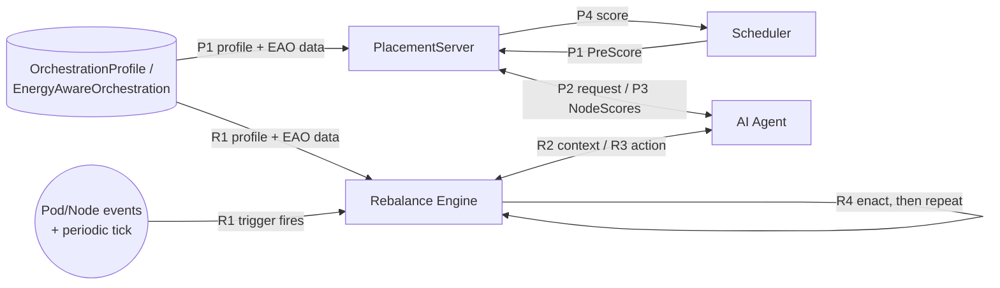
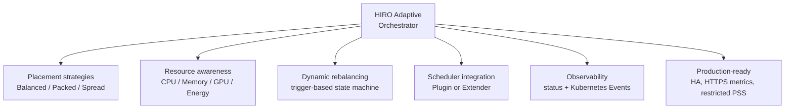
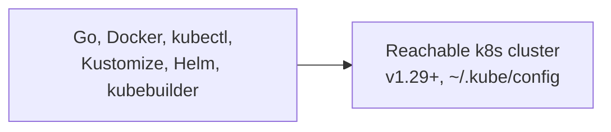
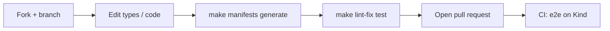

# HIRO Adaptive Orchestrator

Kubernetes decides where a pod runs using fixed, built-in rules, and once a pod is placed it stays
put even if that node later becomes a poor choice. HIRO replaces both halves of that with decisions
delegated to an external AI agent: it scores candidate nodes at scheduling time, then keeps watching
placed workloads and moves them when conditions change.

You describe intent with one custom resource — an `OrchestrationProfile` says "spread this Deployment,
and care about energy" — and the operator handles the rest. It's for platform teams running clusters
where placement quality matters: energy cost, resource pressure, or hardware heterogeneity.

<a id="at-a-glance"></a>

### <u>At a glance</u>

Two independent flows. **Placement** (P1→P4) scores nodes for a pod being scheduled;
**rebalancing** (R1→R4) moves workloads that are already running.



---

## Table of Contents

- [Quick Start](#quick-start)
- [Architecture](#architecture)
- [Features](#features)
- [Prerequisites](#prerequisites)
- [Development Workflow](#development-workflow)
  - [Unit & Integration Tests](#unit--integration-tests)
  - [End-to-End Tests](#end-to-end-tests)
  - [Lint](#lint)
- [Release Process](#release-process)
- [Project Structure](#project-structure)
- [Upgrading Go, Kubernetes, or Kubebuilder Version](#upgrading-go-or-kubernetes-version)
- [Contributing](#contributing)
- [License](#license)

---

<a id="quick-start"></a>

## 🚀 <u>Quick Start</u>

Needs Go, Docker, kubectl, Helm, and Kind on your machine — see [Prerequisites](#prerequisites)
for versions. No Kubernetes cluster required up front; step 1 creates a local Kind one.

**1. Deploy.** Installs the operator, webhook, scheduler, and mock agent as one Helm release
against a local Kind cluster — no registry or GHCR token needed, since images build locally and
load straight into Kind:

```bash
deploy/scripts/deploy_full_stack_with_helm.sh deploy
```

**2. Verify.** The deploy health-checks the PlacementServer and prints the pods, then ends with
copy-pasteable port-forward commands and access URLs — the PlacementServer, the mock agent, and
both `hiro_*` metrics endpoints, with a bearer token already granted so the `curl`s work as
printed. To re-check the pods later:

```bash
kubectl -n hiro-adaptive-orchestrator-system get pods
```

Metrics live on two endpoints, not one: the operator's on `:8443` and the scheduler plugin's on
`:10259`, in separate processes with separate registries. What exists on each, how to turn
scraping and tracing on, and how to read either one is in
**[docs/instrumentation.md](docs/instrumentation.md)**.

**3. Try it.** Apply a sample workload plus a profile that governs it, then watch the status fill in:

```bash
kubectl apply -f config/samples/nginx_deployment_1.yaml \
              -f config/samples/orchestrationprofile_1.yaml

kubectl get orchestrationprofile orchestrationprofile-1 -o yaml
```

`status.status` moves `NoPods → Pending → Active` as the pods come up; status transitions are also
recorded as Kubernetes Events on the profile (`kubectl describe orchestrationprofile orchestrationprofile-1`).

This is also what first exercises the scheduler plugin, so it's worth checking that the AI was
actually consulted — if `hiro_scheduler_plugin_nodes_scored_count` stays at `0` after a pod is
scheduled, the plugin never reached the PlacementServer and fell back to neutral scores silently.

**4. Clean up.** `clean` removes the Helm release and leaves the Kind cluster running, so a
redeploy skips cluster creation. `destroy` deletes the cluster outright:

```bash
deploy/scripts/deploy_full_stack_with_helm.sh clean     # release only
deploy/scripts/deploy_full_stack_with_helm.sh destroy   # the whole Kind cluster
```

### Beyond the defaults

For a real cluster (not Kind), deploy the same umbrella chart at `deploy/helm/hiro-adaptive-platform`
with `make helm-platform-deploy` instead of step 1.

Every parameter has a sane default and can be overridden via environment variables:

```bash
KIND_CLUSTER_NAME=my-cluster deploy/scripts/deploy_full_stack_with_helm.sh deploy

SCHEDULER_MODE=extender    deploy/scripts/deploy_full_stack_with_helm.sh deploy   # patch kube-scheduler instead
DEPLOY_PROMETHEUS=true     deploy/scripts/deploy_full_stack_with_helm.sh deploy   # bundle Prometheus and scrape hiro_*
OTLP_ENDPOINT=alloy:4317   deploy/scripts/deploy_full_stack_with_helm.sh deploy   # export traces
USE_MOCK_AGENT=false       deploy/scripts/deploy_full_stack_with_helm.sh deploy   # point at a real AI agent
```

Each of these drives both the Helm values and the script's closing summary, so what it prints
always matches what was deployed.

Every other deployment path — shell scripts, operator-only, scheduler-only, extender-only, mock agent, manual Kustomize, YAML bundle — plus the full environment-variable reference and phase-by-phase breakdown, is documented in **[docs/deployment.md](docs/deployment.md)**.

---

<a id="architecture"></a>

## 🏗️ <u>Architecture</u>


<a id="components"></a>

### <u>Components</u>

Three binaries get deployed, plus an optional mock agent for local testing:

| Deployed unit | Binary | What it does | Details |
|---|---|---|---|
| **Operator** | `cmd/main.go` | One pod, one process, three parts (below) | [Component wiring](docs/architecture.md#component-wiring) |
| **Scheduler Plugin** | `scheduler-plugin/cmd/main.go` | A custom `kube-scheduler` with the `HIROScore` plugin. Only for the plugin path; the extender path uses the cluster's own scheduler | [Plugin path](docs/architecture.md#plugin-path-hiro-scheduler--placementserver) |
| **AI Decision Service** | `ai-decision-service/cmd/main.go` | Decides placement and rebalance. Asks a model when one is set (off by default), checks its answer, and falls back to code | [Service](ai-decision-service/README.md) · [Use or add a model](docs/decision-models.md) |
| **Mock Decision Agent** | `deploy/manifests/mock_decision_agent.yaml` | Random answers, in place of the AI Decision Service, for local tests | [Mock agent](docs/deployment.md#mock-decision-agent) |

Inside the operator process:

| Part | Package | What it does | Details |
|---|---|---|---|
| **Reconciler** | `internal/controller/` | Watches `OrchestrationProfile` and its workloads, and fills in `status` | [Reconciliation flow](docs/architecture.md#reconciliation-flow) |
| **PlacementServer** | `internal/placement-server/` | HTTP on `:8090`. The scheduler plugin or extender calls it, and it asks the AI Decision Service for node scores | [PlacementServer](docs/architecture.md#placementserver) |
| **Rebalance Engine** | `internal/rebalance/` | Detects triggers, asks the AI Decision Service, and carries out Move, AdjustReplicas, AdjustResources or a retry | [Rebalance engine](internal/rebalance/README.md) |

The `OrchestrationProfile` CRD drives all of it: it binds a placement strategy (`Balanced`, `Packed` or `Spread`) and optional resource awareness (CPU, memory, GPU, energy) to one workload, and reports back in its `status`. Full spec: [OrchestrationProfile CRD](docs/architecture.md#orchestrationprofile-crd). Function-level call traces of both scheduling paths: [docs/scheduling-flows.md](docs/scheduling-flows.md).

---

<a id="features"></a>

## ✨ <u>Features</u>



- **Placement strategies** — `Balanced`, `Packed`, `Spread`
- **Multi-dimensional resource awareness** — CPU, Memory, GPU, Energy
- **Energy-aware orchestration** — optional integration with an `EnergyAwareOrchestration` CRD
- **Dynamic rebalancing** — trigger-based (energy threshold, CPU/memory threshold, node failure, scheduled); hybrid periodic + event-driven detection feeding a decision lifecycle state machine — see [internal/rebalance/README.md](internal/rebalance/README.md)
- **AI decisions with a replaceable model** — the AI Decision Service asks a model (Kev today, any LLM later) for placement and rebalance, checks every answer, and falls back to code; switching models is config only — see [docs/decision-models.md](docs/decision-models.md)
- **Custom scheduler plugin** — `HIROScore` runs as a separate `hiro-scheduler` binary; pods opt in via `schedulerName: hiro-scheduler`
- **Pod scheduler webhook** — `MutatingAdmissionWebhook` auto-sets `spec.schedulerName: hiro-scheduler` on pods governed by an `OrchestrationProfile`; TLS provisioned automatically by cert-manager; enabled with `DEPLOY_SCHEDULER_PLUGIN=true`
- **Scheduler extender support** — for managed clusters where a custom scheduler pod cannot be deployed; uses ClusterIP for reliable reachability from `hostNetwork` kube-scheduler
- **Status observability** — every profile reports `status.status`, standard `status.conditions`, and `observedGeneration`, so `kubectl wait --for=condition=Ready` and GitOps health checks work out of the box
- **Kubernetes events** — status transitions and errors recorded as events on `OrchestrationProfile`
- **Production-ready** — leader election, HTTPS metrics (:8443), Prometheus/ServiceMonitor support, restricted pod security

---

<a id="prerequisites"></a>

## 📋 <u>Prerequisites</u>



| Tool        | Minimum version | Purpose                    |
| ----------- | --------------- | -------------------------- |
| Go          | 1.26            | Build operator from source |
| Docker      | any recent      | Build container images     |
| kubectl     | v1.29+          | Interact with cluster      |
| Kustomize   | v5.8+           | Deploy via manifests       |
| Helm        | v3+             | Deploy via Helm chart      |
| Kind        | any recent      | Local / E2E testing        |
| kubebuilder | v4              | Scaffold / code generation |

A running Kubernetes cluster (v1.29+) with `~/.kube/config` pointing to it is required for deployment.

Some paths need more — cert-manager for the scheduler webhook's TLS, a reachable Decision Agent (a mock is used by default). The recommended Helm path handles both automatically; see [docs/deployment.md](docs/deployment.md) for what each other path needs.

---

<a id="development-workflow"></a>

## 🛠️ <u>Development Workflow</u>

| After editing…            | Run                                                              |
| ------------------------- | ---------------------------------------------------------------- |
| `*_types.go` or markers   | `make manifests` (regenerate CRDs / RBAC) + `make generate` (regenerate DeepCopy) |
| any `*.go` file           | `make lint-fix` (auto-fix style) + `make test` (unit + integration) |
| anything you want running | see **[docs/deployment.md](docs/deployment.md)** for every deployment path |

<a id="unit--integration-tests"></a>

### <u>Unit & Integration Tests</u>

```bash
make test
```

Uses **Ginkgo v2 + Gomega** with `controller-runtime/envtest` (real Kubernetes API server + etcd, no cluster needed). Coverage profile written to `cover.out`.

<a id="end-to-end-tests"></a>

### <u>End-to-End Tests</u>

```bash
make test-e2e
```

Runs against an isolated **Kind** cluster (created and torn down automatically). Never run against a development or production cluster.

<a id="lint"></a>

### <u>Lint</u>

```bash
make lint        # report issues
make lint-fix    # auto-fix where possible
```

Both run on every Go module listed in `GO_MODULES` (root, `scheduler-plugin`, `ai-decision-service`).

> **Never manually edit** auto-generated files: `config/crd/bases/*.yaml`, `config/rbac/role.yaml`, `zz_generated.*.go`, `dist/chart/`, `dist/install.yaml`.

---

<a id="release-process"></a>

## 🚢 <u>Release Process</u>

A merge to `main` auto-tags the next version, builds multi-arch images, packages the Helm
chart, and publishes a GitHub Release; `deploy.yml` then rolls that release out to the target
cluster. See **[docs/release-process.md](docs/release-process.md)** for the full pipeline,
versioning rules, manual releases, and CI/GHCR gotchas.

---

<a id="project-structure"></a>

## 📁 <u>Project Structure</u>

```
cmd/              Operator entry point: manager + PlacementServer
api/v1alpha1/      OrchestrationProfile CRD schema
pkg/placement/     Shared wire types (operator ↔ scheduler plugin)
internal/          controller/, decision/ (PlacementServer), rebalance/, webhook/v1/, utils/
scheduler-plugin/  Separate Go module — hiro-scheduler binary (HIROScore plugin)
config/            Kustomize bases/overlays — CRDs, RBAC, manager, scheduler, extender, webhook, certmanager
deploy/            Everything deployment: scripts/ (full stack, operator, scheduler, extender),
                   manifests/ (mock agent), helm/hiro-adaptive-platform (umbrella chart)
demo/              Narrated rebalance-engine demo against a running stack
hack/              Codegen boilerplate (controller-gen license header)
dist/              Generated Helm chart + install bundle — DO NOT EDIT
test/e2e/          End-to-end tests (Kind)
```

See **[docs/project-structure.md](docs/project-structure.md)** for the full annotated source tree.

---

<a id="upgrading-go-or-kubernetes-version"></a>

## ⬆️ <u>Upgrading Go, Kubernetes, or Kubebuilder Version</u>

Each of these requires keeping 2-3 files in sync by hand (not done automatically by kubebuilder) —
see **[docs/upgrading.md](docs/upgrading.md)** for the exact files and step-by-step procedure for
bumping Go, the scheduler plugin's Kubernetes pin, or Kubebuilder.

---

<a id="contributing"></a>

## 🤝 <u>Contributing</u>



1. Fork the repository and create a feature branch.
2. Run `make manifests generate` after editing types.
3. Run `make lint-fix test` before opening a pull request.
4. E2E tests are validated in CI via GitHub Actions against a Kind cluster.

For detailed development guidelines, Kubebuilder CLI cheat sheet, API design conventions, and logging standards, see [AGENTS.md](./AGENTS.md).

---

<a id="license"></a>

## 📄 <u>License</u>

Licensed under the [Apache License, Version 2.0](https://www.apache.org/licenses/LICENSE-2.0).
