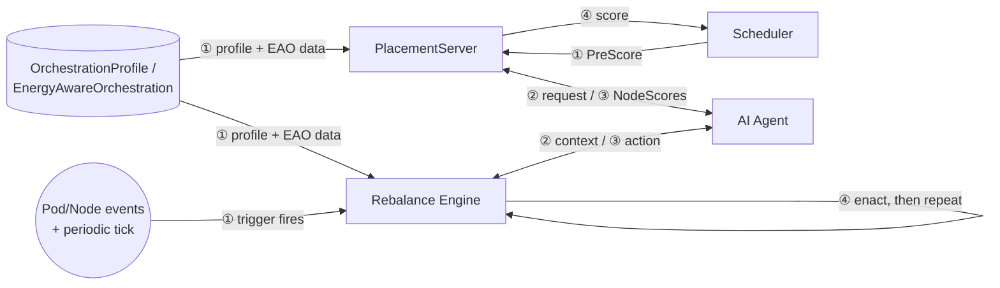
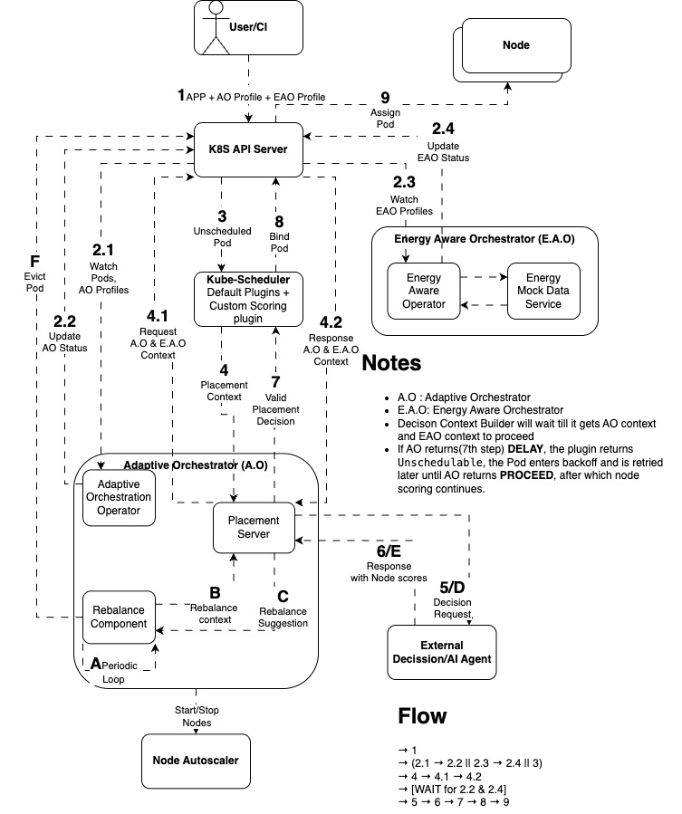
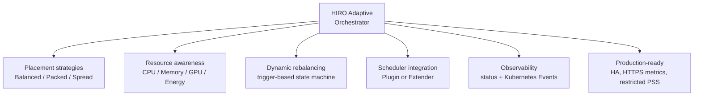
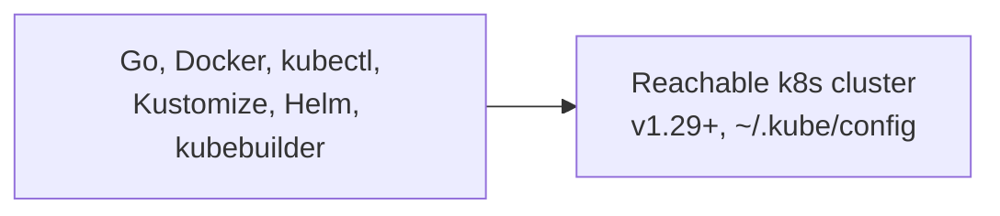
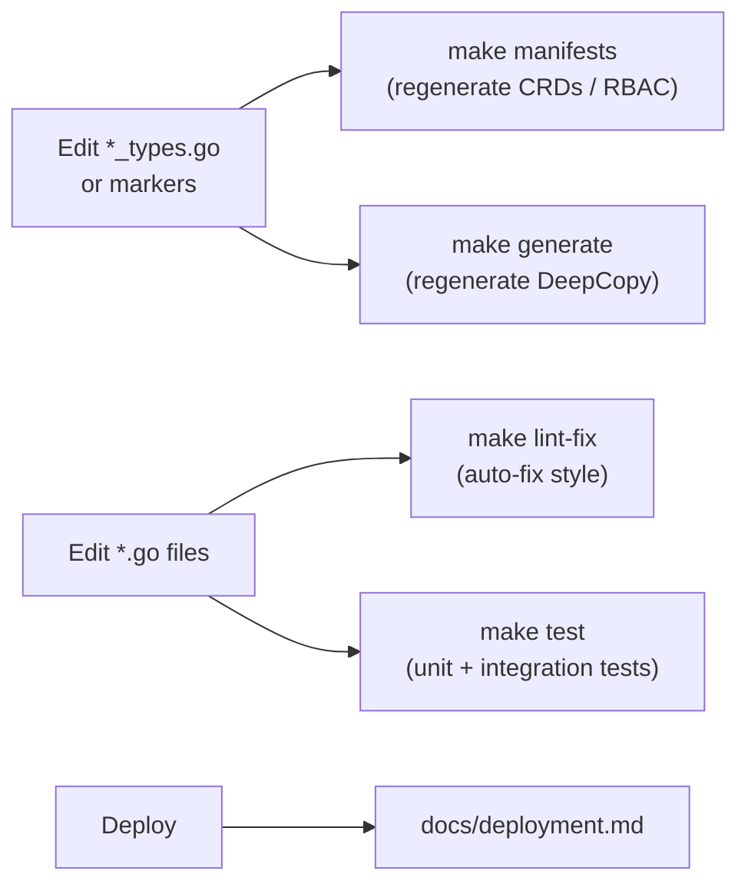
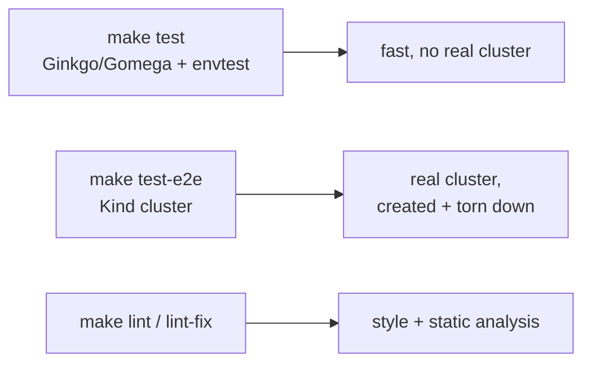
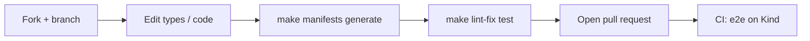

# HIRO Adaptive Orchestrator

A Kubernetes operator that provides intelligent, AI-driven pod placement and adaptive workload orchestration. It introduces the `OrchestrationProfile` custom resource to bind placement strategies to workloads, and integrates with the Kubernetes scheduler to score nodes using an external AI decision agent.

<a id="at-a-glance"></a>

### <u>At a glance</u>



---

## Table of Contents

- [Architecture](#architecture)
- [Features](#features)
- [Prerequisites](#prerequisites)
- [Quick Start](#quick-start)
- [Deployment](#deployment)
- [Development Workflow](#development-workflow)
  - [Unit & Integration Tests](#unit--integration-tests)
  - [End-to-End Tests](#end-to-end-tests)
  - [Lint](#lint)
- [Release Process](#release-process)
- [Project Structure](#project-structure)
- [Upgrading Go, Kubernetes, or Kubebuilder Version](#upgrading-go-or-kubernetes-version)
- [Project Initialization](#project-initialization)
- [Contributing](#contributing)
- [License](#license)

---

<a id="architecture"></a>

## 🏗️ <u>Architecture</u>



<a id="components"></a>

### <u>Components</u>

The system consists of two independently deployed binaries plus an optional mock AI agent:

| Component               | Binary / File                   | Description                                                                                                                                                                                                                                                                                                                                                                          |
| ----------------------- | ------------------------------- | ------------------------------------------------------------------------------------------------------------------------------------------------------------------------------------------------------------------------------------------------------------------------------------------------------------------------------------------------------------------------------------ |
| **Operator**            | `cmd/main.go`                   | Single pod running three cooperating parts in one process: the placement Reconciler, the Rebalance Engine, and the PlacementServer HTTP service (`:8090`) serving 4 routes — plugin path, extender filter, extender prioritize, healthz                                                                                                                                              |
| **PlacementServer**     | `internal/placement-server/`    | Single HTTP listener on `:8090` inside the operator pod, serving 4 routes: `/api/v1/placement/decision`, `/extender/filter`, `/extender/prioritize`, `/healthz` — see [PlacementServer](docs/architecture.md#placementserver)                                                                                                                                                        |
| **Scheduler Plugin**    | `scheduler-plugin/cmd/main.go`  | Custom `kube-scheduler` binary with `HIROScore` plugin registered                                                                                                                                                                                                                                                                                                                    |
| **Rebalance Engine**    | `internal/rebalance/`           | Hybrid periodic + event-driven trigger detection → AI-consulted decision lifecycle (`Watching → Triggered → Evaluating → Decided → Enacting`) → action enactment (`Move`, `RetryPendingSchedule`); shares a `DecisionStore` with the PlacementServer so an accepted `Move` biases where the replacement pod lands — see [internal/rebalance/README.md](internal/rebalance/README.md) |
| **Mock Decision Agent** | `hack/mock_decision_agent.yaml` | Lightweight Python HTTP server for local/CI testing; scores placement candidates randomly and responds to rebalance evaluations (Move/NoOp)                                                                                                                                                                                                                                          |

The `OrchestrationProfile` CRD binds a placement strategy (`Balanced`/`Packed`/`Spread`) and
optional resource awareness (CPU/Memory/GPU/Energy) to a workload; its status reports
`NoPods → Pending → Active/Partial/Degraded/Error`.

See **[docs/architecture.md](docs/architecture.md)** for the component wiring diagram, the
reconciliation flow, the Plugin and Extender request paths, and the full `OrchestrationProfile`
CRD spec — **[internal/rebalance/README.md](internal/rebalance/README.md)** for the rebalance
engine's decision lifecycle — and **[docs/scheduling-flows.md](docs/scheduling-flows.md)** for
function-level call traces of both scheduling paths.

---

<a id="features"></a>

## ✨ <u>Features</u>



- **Placement strategies** — `Balanced`, `Packed`, `Spread`
- **Multi-dimensional resource awareness** — CPU, Memory, GPU, Energy
- **Energy-aware orchestration** — optional integration with an `EnergyAwareOrchestration` CRD
- **Dynamic rebalancing** — trigger-based (energy threshold, CPU/memory threshold, node failure, scheduled); hybrid periodic + event-driven detection feeding a decision lifecycle state machine — see [internal/rebalance/README.md](internal/rebalance/README.md)
- **AI-delegated scoring** — pluggable external decision agent via HTTP
- **Custom scheduler plugin** — `HIROScore` runs as a separate `hiro-scheduler` binary; pods opt in via `schedulerName: hiro-scheduler`
- **Pod scheduler webhook** — `MutatingAdmissionWebhook` auto-sets `spec.schedulerName: hiro-scheduler` on pods governed by an `OrchestrationProfile`; TLS provisioned automatically by cert-manager; enabled with `DEPLOY_SCHEDULER_PLUGIN=true`
- **Scheduler extender support** — for managed clusters where a custom scheduler pod cannot be deployed; uses ClusterIP for reliable reachability from `hostNetwork` kube-scheduler
- **Status observability** — `NoPods` → `Pending` → `Active` → `Partial` → `Degraded` → `Error`
- **Kubernetes events** — status transitions and errors recorded as events on `OrchestrationProfile`
- **Production-ready** — leader election, HTTPS metrics (:8443), Prometheus/ServiceMonitor support, restricted pod security

---

<a id="prerequisites"></a>

## 📋 <u>Prerequisites</u>



| Tool        | Minimum version | Purpose                    |
| ----------- | --------------- | -------------------------- |
| Go          | 1.26            | Build operator from source |
| Docker      | any recent      | Build container images     |
| kubectl     | v1.29+          | Interact with cluster      |
| Kustomize   | v5.8+           | Deploy via manifests       |
| Helm        | v3+             | Deploy via Helm chart      |
| Kind        | any recent      | Local / E2E testing        |
| kubebuilder | v4              | Scaffold / code generation |

A running Kubernetes cluster (v1.29+) with `~/.kube/config` pointing to it is required for deployment.

Some paths need more — cert-manager for the scheduler webhook's TLS, a reachable Decision Agent (a mock is used by default). The recommended Helm path handles both automatically; see [docs/deployment.md](docs/deployment.md) for what each other path needs.

---

<a id="quick-start"></a>

## 🚀 <u>Quick Start</u>

```bash
hack/deploy_full_stack_with_helm.sh deploy
```

Installs the operator, webhook, scheduler, and mock agent as one Helm release against a local Kind cluster — no registry needed. See [Deployment](#deployment) for every other way to deploy.

---

<a id="deployment"></a>

## 📦 <u>Deployment</u>

**`hack/deploy_full_stack_with_helm.sh deploy`** (local Kind) or **`make helm-platform-deploy`** (real cluster) is the recommended way to deploy the full stack, via the Helm umbrella chart at `charts/hiro-adaptive-platform`.

Every other path — shell scripts, operator-only, scheduler-only, extender-only, mock agent, manual Kustomize, YAML bundle — plus the full parameter reference and phase-by-phase breakdown, is documented in **[docs/deployment.md](docs/deployment.md)**.

---

<a id="development-workflow"></a>

## 🛠️ <u>Development Workflow</u>

```
Edit *_types.go or markers
        ├── make manifests   (regenerate CRDs / RBAC)
        └── make generate    (regenerate DeepCopy)

Edit *.go files
        ├── make lint-fix    (auto-fix style)
        └── make test        (unit + integration tests)

Deploy
        └── see docs/deployment.md for every deployment path
```





<a id="unit--integration-tests"></a>

### <u>Unit & Integration Tests</u>

```bash
make test
```

Uses **Ginkgo v2 + Gomega** with `controller-runtime/envtest` (real Kubernetes API server + etcd, no cluster needed). Coverage profile written to `cover.out`.

<a id="end-to-end-tests"></a>

### <u>End-to-End Tests</u>

```bash
make test-e2e
```

Runs against an isolated **Kind** cluster (created and torn down automatically). Never run against a development or production cluster.

<a id="lint"></a>

### <u>Lint</u>

```bash
make lint        # report issues
make lint-fix    # auto-fix where possible
```

> **Never manually edit** auto-generated files: `config/crd/bases/*.yaml`, `config/rbac/role.yaml`, `zz_generated.*.go`, `dist/chart/`, `dist/install.yaml`.

---

<a id="release-process"></a>

## 🚢 <u>Release Process</u>

A merge to `main` auto-tags the next version, builds multi-arch images, packages the Helm
chart, and publishes a GitHub Release; `deploy.yml` then rolls that release out to the target
cluster. See **[docs/release-process.md](docs/release-process.md)** for the full pipeline,
versioning rules, manual releases, and CI/GHCR gotchas.

---

<a id="project-structure"></a>

## 📁 <u>Project Structure</u>

```
cmd/              Operator entry point: manager + PlacementServer
api/v1alpha1/      OrchestrationProfile CRD schema
pkg/placement/     Shared wire types (operator ↔ scheduler plugin)
internal/          controller/, decision/ (PlacementServer), rebalance/, webhook/v1/, utils/
scheduler-plugin/  Separate Go module — hiro-scheduler binary (HIROScore plugin)
config/            Kustomize bases/overlays — CRDs, RBAC, manager, scheduler, extender, webhook, certmanager
hack/              Deploy scripts (full stack, operator, scheduler, extender) + mock agent
dist/              Generated Helm chart + install bundle — DO NOT EDIT
test/e2e/          End-to-end tests (Kind)
```

See **[docs/project-structure.md](docs/project-structure.md)** for the full annotated source tree.

---

<a id="upgrading-go-or-kubernetes-version"></a>

## ⬆️ <u>Upgrading Go, Kubernetes, or Kubebuilder Version</u>

Each of these requires keeping 2-3 files in sync by hand (not done automatically by kubebuilder) —
see **[docs/upgrading.md](docs/upgrading.md)** for the exact files and step-by-step procedure for
bumping Go, the scheduler plugin's Kubernetes pin, or Kubebuilder.

---

<a id="project-initialization"></a>

## 🌱 <u>Project Initialization</u>

Scaffolded using [Kubebuilder](https://book.kubebuilder.io/):

```bash
kubebuilder init \
  --domain orchestration.hiro.io \
  --repo github.com/HIRO-MicroDataCenters-BV/hiro-adaptive-orchestrator \
  --owner "HIRO Adaptive Orchestrator"

kubebuilder create api \
  --group orchestration --version v1alpha1 --kind OrchestrationProfile \
  --resource=true --controller=true

kubebuilder edit --plugins=helm/v2-alpha
```

> Do **not** re-run these on an existing checkout — they modify project scaffolding.

---

<a id="contributing"></a>

## 🤝 <u>Contributing</u>



1. Fork the repository and create a feature branch.
2. Run `make manifests generate` after editing types.
3. Run `make lint-fix test` before opening a pull request.
4. E2E tests are validated in CI via GitHub Actions against a Kind cluster.

For detailed development guidelines, Kubebuilder CLI cheat sheet, API design conventions, and logging standards, see [AGENTS.md](./AGENTS.md).

---

<a id="license"></a>

## 📄 <u>License</u>

Licensed under the [Apache License, Version 2.0](https://www.apache.org/licenses/LICENSE-2.0).
