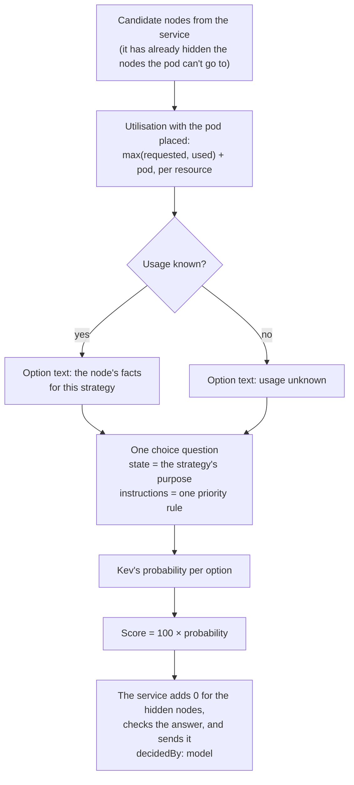

# Kev placement adapter

Provider `kev`. Asks Kev, through its System One API, where to place a pod: **one call per pod, one `choice` question over the candidate nodes**.

| File | What it holds |
|---|---|
| `kev_model.go` | The adapter: question wording, node facts, call, reply → scores |
| `kev_model_test.go` | Exact wording per strategy, and every error path, against a fake Kev |
| `kev_model.md` | This page |

To switch, replace or add a model, see [docs/decision-models.md](../../docs/decision-models.md). Replacing Kev means swapping these three files and its `case` in `model.New`; nothing else changes.

## Wiring

Off by default. To turn Kev on, set:

| Setting | Value |
|---|---|
| `AI_DECISION_SERVICE_MODEL_PROVIDER` | `kev` |
| `AI_DECISION_SERVICE_MODEL_BASE_URL` | Kev's address, e.g. `http://host.docker.internal:8009` with Kev on your machine and Kind on Docker Desktop |
| `AI_DECISION_SERVICE_MODEL_PATH` | `/v1/systemone` |
| `AI_DECISION_SERVICE_MODEL_NAME` | `kev-latest` |
| `AI_DECISION_SERVICE_MODEL_TIMEOUT` | `5000ms`, the default |

The address for each setup, and how to set these with Helm or the Kind script, are in [Switch a model](../../docs/decision-models.md#2-switch-a-model).

**Kev's API**, as used here:

```text
POST {base URL}{path}
  { "state": "...", "model": "kev-latest",
    "questions": { "placement": { "type": "choice", "instructions": "...", "criteria": { "<node>": "<facts>", ... } } } }
→ { "answers": { "placement": { "choice": "<node>", "confidence": 0.8, "probabilities": { "<node>": 0.83, ... } } } }
```

## How it works



1. **Utilisation** uses `scorer.Utilization` with the pod placed, so a node busy above its requests doesn't look empty.
2. **Nodes the pod can't go to** never reach Kev: the service hides them and scores them 0 itself. That also keeps them from distracting Kev, which ignores "over the limit" text in options.
3. **No node left:** the service doesn't call Kev, and the scorer answers.
4. **Scores:** each asked node gets 100 × Kev's probability; the reason names Kev's pick, e.g. `Packed: node-2 best (probability 0.83)`, and Kev's confidence is passed on.
5. **Any error** (Kev down, HTTP error, bad JSON, missing answer or probability, timeout) makes the scorer answer, with `decidedBy: fallback`.

## What Kev reads

The state is always `Choosing a node for a new pod of this app, which requests {CPU}m CPU and {memory}Mi memory. ` followed by the strategy's purpose. The instructions are always `Which node is the best place for this pod? ` followed by one priority rule. Every number includes the new pod.

| Strategy | Purpose (state) | Priority (instructions) | One node's facts (option text) |
|---|---|---|---|
| Balanced | Strategy: Balanced. The app is latency sensitive, so no node should become a hotspot on any resource. | Under Balanced, the node with lower CPU and memory use is the better place. | with this pod placed, cpu would be at 30% and memory at 25% |
| Packed | Strategy: Packed. To save energy, fill nodes that are already in use so other nodes can stay empty, but no node may go over 85% on any resource. | Under Packed, the fuller node is the better place. | with this pod placed, it would be 59% full on average; cpu would be at 60% and memory at 58% |
| Spread | Strategy: Spread. For high availability, keep this app's pods apart, so that losing one node, or one zone, takes down as few of them as possible. | Under Spread, fewer of this app's pods in the node's zone is better; if that is the same, fewer of this app's pods on the node is better; only if both are the same, the less busy node is better. | this app already runs 2 pods in this node's zone, a, and 1 pod on this node; with this pod placed, its busiest resource, cpu, would be at 45%; cpu would be at 45% and memory at 30% |

- Packed's 85% is `AI_DECISION_SERVICE_SCORER_PACKED_MAX_UTIL`.
- Spread's zone comes from `AI_DECISION_SERVICE_SCORER_ZONE_LABEL`. Zone counts include this app's pods on nodes that aren't candidates. A node without a zone label reads `this app already runs 1 pod on this node; …`.
- The resources listed follow the profile's awareness flags (CPU and memory when none are set).

### Example: Packed, three nodes, a 50m / 64Mi pod

| Node | With the pod placed | Allowed under Packed (85%) |
|---|---|---|
| node-1 | cpu 88%, memory 80% | no: the service hides it and scores it 0 |
| node-2 | cpu 60%, memory 58% | yes |
| node-3 | cpu 30%, memory 30% | yes |

Sent to Kev:

```json
{
  "state": "Choosing a node for a new pod of this app, which requests 50m CPU and 64Mi memory. Strategy: Packed. To save energy, fill nodes that are already in use so other nodes can stay empty, but no node may go over 85% on any resource.",
  "model": "kev-latest",
  "questions": {
    "placement": {
      "type": "choice",
      "instructions": "Which node is the best place for this pod? Under Packed, the fuller node is the better place.",
      "criteria": {
        "node-2": "with this pod placed, it would be 59% full on average; cpu would be at 60% and memory at 58%",
        "node-3": "with this pod placed, it would be 30% full on average; cpu would be at 30% and memory at 30%"
      }
    }
  }
}
```

Kev replies `node-2` with probabilities `{"node-2": 0.83, "node-3": 0.17}`. The answer is node-1 → 0, node-2 → 83, node-3 → 17, reason `Packed: node-2 best (probability 0.83)`.

## Why it is shaped this way

Each choice was measured against Kev before it went in:

| Choice | Why |
|---|---|
| Kev never sees nodes the pod can't go to (the service hides them) | Kev ignores "over the limit" text in options. With the new wording alone, Packed reached 22 of 29; hiding those nodes took it to 26. |
| Numbers include the new pod | Without it, a big pod's effect on a node is invisible. |
| The state gives the strategy's purpose; the instructions give one positive rule | Negated rules ("whatever its pod count", "even if it is busier") made Kev pick worse. |
| Each node's facts lead with what the strategy ranks by | Packed reads its average fullness first; Spread reads zone, then node pods. |
| No band words ("high", "low"), and not every value in one sentence | Both were measured; neither helped. |

## Measured accuracy

One call per scenario, 85 scenarios (25 hand-made, 60 random), each judged against the strategy's **purpose**, not against the scorer:

| | Balanced (28) | Packed (29) | Spread (28) | Total (85) |
|---|---|---|---|---|
| Kev, current wording | 22 | 26 | 21 | **69** (81%) |
| Kev, previous wording | 24 | 15 | 22 | 61 (72%) |
| Scorer | 26 | 29 | 28 | 83 (98%) |

- Balanced and Spread move by ±2 between wordings, which is within the noise. The real gain is Packed.
- Latency: about 0.45 s for 2 nodes and 1.1 s for 10 nodes per call, with Kev on a laptop.

## Known gaps

1. **Five or more nodes:** one choice over many options often misses the best node.
2. **Close or uneven numbers:** e.g. under Balanced, Kev can prefer cpu 10% / memory 60% over 45% / 45%, the very hotspot Balanced avoids.
3. **Spread order:** Kev doesn't strictly apply zone, then node pods, then usage, when a lower fact has the bigger gap.
4. **Facts not sent:** images already on the node, GPU, taints and energy (null today). In trials Kev used energy facts, but ignored image, GPU and taint facts.
5. **Unknown usage:** such a node can't be checked against the limit, so the service keeps it as a candidate, as the scorer does, and Kev reads `usage unknown`.
6. **Latency** grows with the number of nodes.

## Next steps

1. **Fine-tune Kev** on labelled placement scenarios. Generate the labels from each strategy's purpose (not from the scorer), covering 2 to 10 nodes, close calls and zones.
2. **Pairwise knockout:** ask about two nodes at a time, in both orders, and let winners go on to the next round. In trials it got close to 100% on Balanced and Packed and about 75% on Spread, but it needs one call per round (about 3 s for 10 nodes).
3. **Scorer fallback fix:** the Balanced imbalance penalty can pick a node that is busier on every resource. Use it only as a tie-break. This helps every model, since the scorer is the shared fallback.
4. **Kev in the cluster,** on a GPU node where one exists, instead of on a laptop.
5. **More facts,** each measured before it goes in: energy first, since Kev uses it.
