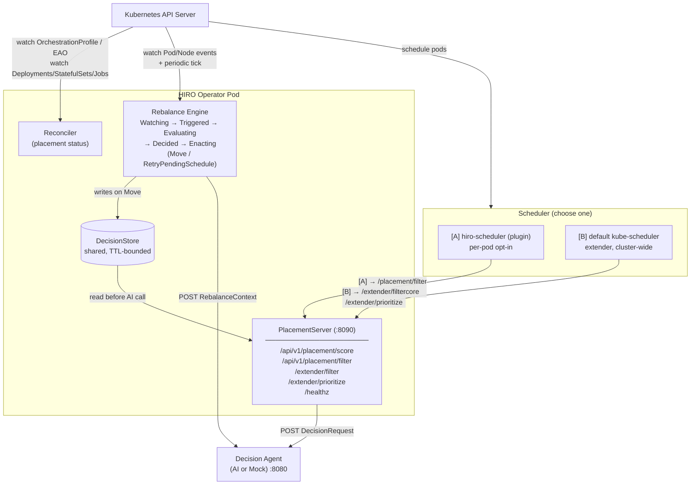
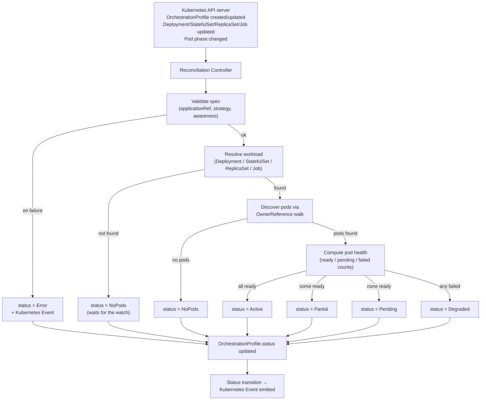
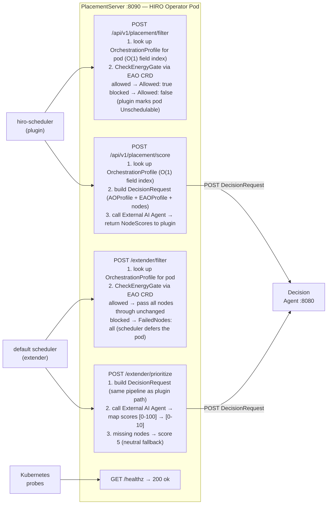
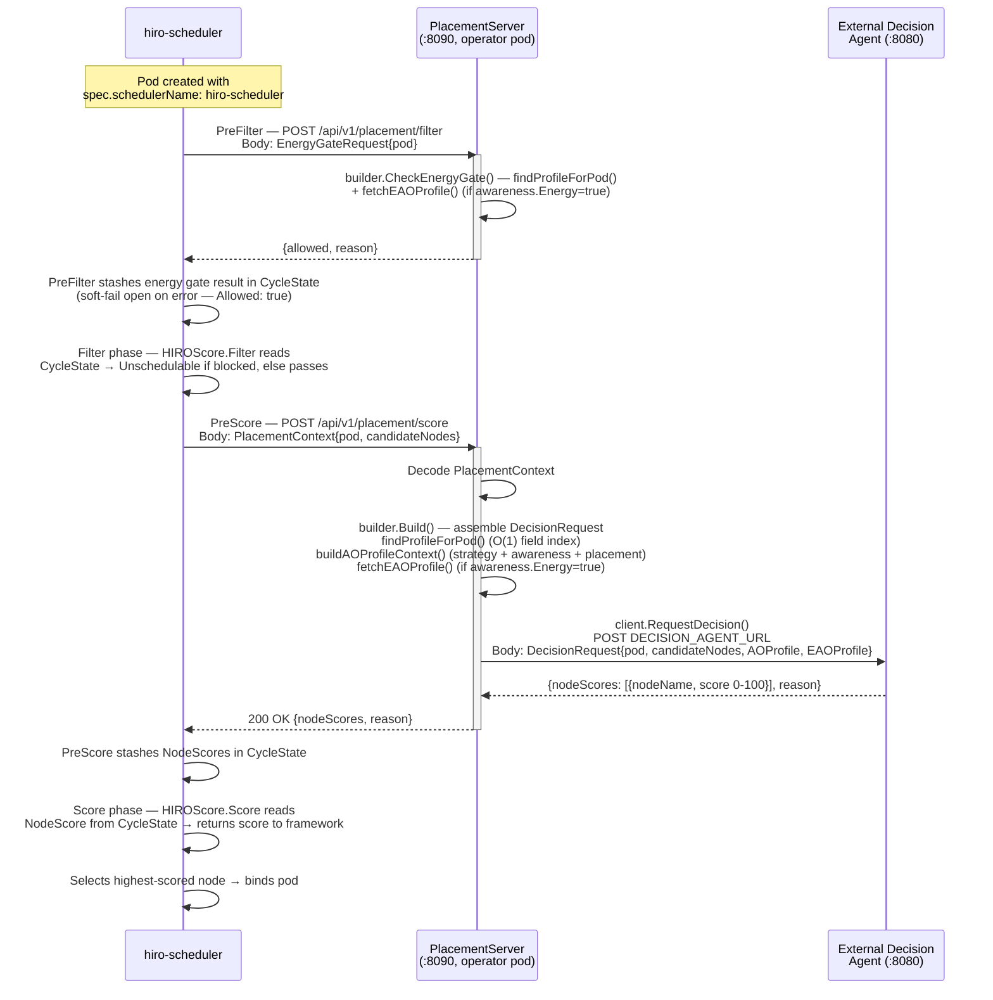
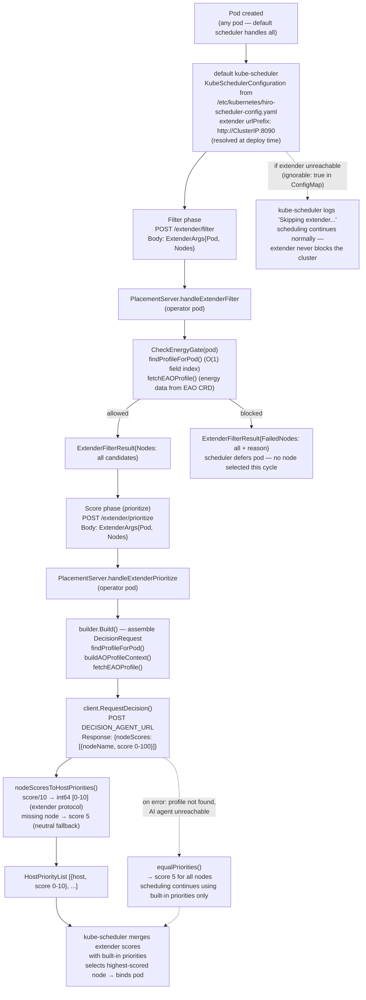

# Architecture

Referenced from the main [README](../README.md#architecture), which only covers the component
table — this file has the full detail: component wiring, the reconciliation flow, the Plugin and
Extender request paths, and the `OrchestrationProfile` CRD spec.

See also [internal/rebalance/README.md](../internal/rebalance/README.md) for the rebalance
engine's decision lifecycle, and [docs/scheduling-flows.md](scheduling-flows.md) for
function-level call traces of both scheduling paths.

## Component Wiring

```
┌───────────────────────────────────────────────────────────────────────┐
│  Kubernetes API Server                                                │
└──────────┬──────────────────────────────────────────┬──────────────────┘
           │ watch OrchestrationProfile / EAO          │ schedule pods
           │ watch Deployments/StatefulSets/Jobs       │
           │ watch Pod/Node events + periodic tick     │
           ▼                                           │
┌────────────────────────────────────────┐   ┌─────────┴───────────────────┐
│  HIRO Operator Pod                      │   │  Scheduler (choose one)     │
│  ──────────────────────────────────    │   │  ─────────────────────────  │
│  Reconciler (placement status)          │   │  [A] hiro-scheduler(plugin) │
│                                          │   │      per-pod opt-in        │
│  Rebalance Engine                       │   │  [B] default kube-scheduler │
│    Watching → Triggered → Evaluating    │   │      extender, cluster-wide │
│    → Decided → Enacting                 │   │                             │
│    (Move / RetryPendingSchedule)        │◄──┤  [A] → /placement/filter    │
│    │ writes on Move                     │   │       /placement/score      │
│    ▼                                    │   │  [B] → /extender/filter     │
│  DecisionStore (shared, TTL-bounded)    │   │       /extender/prioritize  │
│    │ read before AI call                │   │                             │
│    ▼                                    │   │                             │
│  PlacementServer (:8090)                │   │                             │
│  ──────────────────────────────────    │   │                             │
│  /api/v1/placement/score                │   │                             │
│  /api/v1/placement/filter               │   │                             │
│  /extender/filter                       │   │                             │
│  /extender/prioritize                   │   │                             │
│  /healthz                               │   │                             │
└──────────────────┬───────────────────────┘   └─────────────────────────────┘
                   │ POST DecisionRequest / RebalanceContext
                   ▼
         ┌──────────────────────┐
         │  Decision Agent      │
         │  (AI or Mock) :8080  │
         └──────────────────────┘
```



<a id="reconciliation-flow"></a>
## Reconciliation Flow

```
Kubernetes API server
        │  OrchestrationProfile created / updated
        │  Deployment / StatefulSet / ReplicaSet / Job updated
        │  Pod phase changed
        ▼
Reconciliation Controller
        ├── Validate spec (applicationRef, strategy, awareness)
        │       on failure → status=Error + Kubernetes Event
        ├── Resolve workload (Deployment / StatefulSet / ReplicaSet / Job)
        │       not found → status=NoPods (waits for the watch to re-trigger)
        ├── Discover pods via OwnerReference walk
        │       no pods   → status=NoPods
        ├── Compute pod health (ready / pending / failed counts)
        │       all ready  → status=Active
        │       some ready → status=Partial
        │       none ready → status=Pending
        │       any failed → status=Degraded
        ▼
OrchestrationProfile.status updated
        └── Status transition → Kubernetes Event emitted
```



<a id="placementserver"></a>
## PlacementServer

The `PlacementServer` is a **single HTTP listener on `:8090`** inside the operator pod. Both scheduler integration approaches — plugin and extender — call the same server on different routes. There is no separate binary or process: it is one `net/http` mux started by `cmd/main.go` alongside the reconciler.



> The plugin's `/placement/filter` + `/placement/score` and the extender's `/extender/filter` + `/extender/prioritize` all share the same underlying `s.filter()` / `s.score()` core (`builder.CheckEnergyGate()` / `DecisionContextBuilder.Build()` + `DecisionClient.RequestDecision()`) — see [docs/scheduling-flows.md](scheduling-flows.md#shared-vs-protocol-specific). Each path's filter step runs `CheckEnergyGate` first; each path's score/prioritize step calls the AI agent, differing only in response shape (plugin: raw 0–100 `NodeScores`; extender: normalised 0–10 `HostPriorityList`).

<a id="plugin-path-hiro-scheduler--placementserver"></a>
## Plugin Path: hiro-scheduler + PlacementServer

End-to-end flow for pods with `spec.schedulerName: hiro-scheduler`. The `HIROScore` plugin runs inside the `hiro-scheduler` pod; the `PlacementServer` runs inside the operator pod. They communicate via HTTP on two routes — `/api/v1/placement/filter` (energy gate) and `/api/v1/placement/score` (AI scoring).




Plugin configuration (URL, path, timeout) is injected into the `KubeSchedulerConfiguration` ConfigMap at deploy time — see [Scheduler Plugin Config](deployment.md#scheduler-plugin-config).

For a detailed function-level trace of every call in this path see [docs/scheduling-flows.md — Path A](scheduling-flows.md#path-a--scheduler-plugin-hiro-scheduler).

<a id="extender-path-default-kube-scheduler--placementserver"></a>
## Extender Path: default kube-scheduler + PlacementServer

End-to-end flow when the extender is deployed. The default `kube-scheduler` calls the PlacementServer during its filter and prioritize phases for **all pods** cluster-wide. No custom scheduler pod is needed.

> **Why ClusterIP, not DNS?** `kube-scheduler` runs with `hostNetwork: true` and uses the node's `/etc/resolv.conf` — not CoreDNS — so `svc.cluster.local` names are unresolvable. kube-proxy iptables/eBPF rules make ClusterIPs reachable from the node network namespace on all cluster types. `deploy_extender.sh` resolves the ClusterIP at deploy time and embeds it in `urlPrefix`.

```
Pod created (any pod — default scheduler handles all)
        ▼
default kube-scheduler
        │  KubeSchedulerConfiguration from /etc/kubernetes/hiro-scheduler-config.yaml
        │  extender urlPrefix: http://<ClusterIP>:8090   ← resolved at deploy time
        │
        ├── Filter phase
        │     POST /extender/filter
        │     Body: ExtenderArgs { Pod *corev1.Pod, Nodes *corev1.NodeList }
        │             ▼
        │     PlacementServer.handleExtenderFilter (operator pod)
        │             ├── CheckEnergyGate(pod)
        │             │     ├── findProfileForPod()   O(1) field index
        │             │     └── fetchEAOProfile()     energy data from EAO CRD
        │             │
        │             ├── allowed  → ExtenderFilterResult { Nodes: all candidates }
        │             └── blocked  → ExtenderFilterResult { FailedNodes: all + reason }
        │                           scheduler defers pod — no node selected this cycle
        │
        └── Score phase (prioritize)
              POST /extender/prioritize
              Body: ExtenderArgs { Pod *corev1.Pod, Nodes *corev1.NodeList }
                      ▼
              PlacementServer.handleExtenderPrioritize (operator pod)
                      ├── builder.Build() — assemble DecisionRequest
                      │     ├── findProfileForPod()
                      │     ├── buildAOProfileContext()
                      │     └── fetchEAOProfile()
                      │
                      ├── client.RequestDecision()
                      │     POST DECISION_AGENT_URL
                      │     Response: { nodeScores: [{nodeName, score 0-100}, ...] }
                      │
                      ├── nodeScoresToHostPriorities()
                      │     score / 10  →  int64 [0-10]  (extender protocol)
                      │     missing node → score 5       (neutral fallback)
                      │
                      └── HostPriorityList [ {host, score 0-10}, ... ]
                              ▼
              kube-scheduler merges extender scores with built-in priorities
              selects highest-scored node → binds pod

On any error (profile not found, AI agent unreachable):
        handleExtenderPrioritize → equalPriorities() → score 5 for all nodes
        scheduling continues using built-in priorities only

If extender is unreachable (ignorable: true in ConfigMap):
        kube-scheduler logs "Skipping extender as it returned error and has ignorable flag set"
        scheduling continues normally — extender never blocks the cluster
```



`ignorable: true` is set in `config/extender/scheduler-config.yaml`. The extender is never a hard dependency for scheduling.

For a detailed function-level trace of every call in this path see [docs/scheduling-flows.md — Path B](scheduling-flows.md#path-b--extender-default-kube-scheduler).

<a id="operator-logs-extender-side"></a>
### Operator logs (extender side)

| Event | Log message |
|-------|-------------|
| Filter request received | `"extender filter request received"` with pod/namespace/nodeCount |
| Energy gate blocked | `"extender filter: energy gate blocked scheduling"` with reason/blockedNodes |
| Prioritize request received | `"extender prioritize request received"` with pod/namespace/nodeCount |
| Prioritize response sent | `"extender prioritize response sent"` with topNode/nodeCount |

<a id="orchestrationprofile-crd"></a>
## OrchestrationProfile CRD

`OrchestrationProfile` is a cluster-scoped resource.

```yaml
apiVersion: orchestration.hiro.io/v1alpha1
kind: OrchestrationProfile
metadata:
  name: my-app-profile
spec:
  applicationRef:             # immutable after creation
    apiVersion: apps/v1
    kind: Deployment          # Deployment | StatefulSet | ReplicaSet | Job
    name: my-app
    namespace: default

  placement:
    strategy: Spread          # Balanced | Packed | Spread
    awareness:
      cpu: false
      memory: false
      gpu: false
      energy: true            # Enables EAOProfileContext enrichment

  rebalancing:
    enabled: true
    cooldownSeconds: 300
    triggerConditions:
      - "EnergyThreshold"     # EnergyThreshold | CPUThreshold | MemoryThreshold
                              # | NodeFailure | PeriodicReview
    replicasExternallyManaged: false   # true: an HPA/KEDA/GitOps owns replicas — never changed
    resourcesExternallyManaged: false  # true: a VPA or similar owns CPU/memory — never changed
```

`kind`, `strategy`, and `triggerConditions` are CRD-enforced enums — an unsupported value is rejected by the API server at `kubectl apply`/`helm upgrade` time, not accepted and surfaced later as `status.Error`.

For pods to be handled by the HIRO scheduler plugin, add to the pod template:

```yaml
spec:
  schedulerName: hiro-scheduler
```

**When `DEPLOY_SCHEDULER_PLUGIN=true`, you do not need to set `schedulerName` manually.** The `MutatingAdmissionWebhook` automatically sets `spec.schedulerName: hiro-scheduler` on any pod whose owning workload is referenced by an `OrchestrationProfile`. The webhook runs at pod CREATE time with `failurePolicy: Ignore` — pods are never blocked if the webhook is unavailable.

Pods without `schedulerName` (and not covered by a profile) use the default scheduler. When the extender approach is deployed, the default scheduler calls HIRO automatically for all pods.

<a id="placement-strategies"></a>
### Placement Strategies

The AI Decision Service's code scorer turns the strategy into a 0–100 score per candidate node, using utilisation after placing the pod. See [`ai-decision-service/README.md`](../ai-decision-service/README.md) for the formulas and settings.

| Strategy | Use when | Behaviour |
|----------|----------|-----------|
| `Balanced` (default) | General, latency-sensitive services | Prefers the least-full node, so no node gets hot; small penalty when CPU and memory use are uneven |
| `Packed` | Saving energy and cost | Prefers fuller nodes so others stay empty, but never above the packed limit (default 85%) |
| `Spread` | High availability | Prefers the zone, then the node, with the fewest of this app's pods; without zone labels, nodes only |

<a id="profile-status"></a>
### Profile Status

| Status | Meaning |
|--------|---------|
| `NoPods` | Referenced application has no pods yet |
| `Pending` | Pods exist but none are ready |
| `Active` | All observed pods are ready |
| `Partial` | Some pods are ready; others are pending |
| `Degraded` | One or more pods failed |
| `Error` | Spec validation failed, or an API error occurred while checking/discovering the referenced workload (a workload that simply doesn't exist *yet* is `NoPods`, not `Error`) |

<a id="status-conditions"></a>
### Status Conditions

`status.conditions` and `status.observedGeneration` follow the standard Kubernetes convention, so generic tooling (`kubectl wait --for=condition=...`, GitOps health checks) works without knowing anything `OrchestrationProfile`-specific:

| Condition | Set by | Meaning |
|---|---|---|
| `Ready` | Placement controller | Mirrors `status.status` — `True` only when `Active`. |
| `RebalancingEscalated` | Rebalance engine | `True` when the rebalance loop has paused itself after repeated failures (see [internal/rebalance/README.md](../internal/rebalance/README.md#escalation--pausing-on-repeated-failures)) — independent of `Ready`, since pods can be perfectly healthy while rebalancing is stuck needing a human. Only present once `spec.rebalancing.enabled: true` and at least one rebalance cycle has run. |

`status.observedGeneration` tells you whether the status above actually reflects your latest edit (compare it to `metadata.generation`) — useful right after a spec change, before the controller has had a chance to reconcile it.

```bash
kubectl describe orchestrationprofile <name>
```
