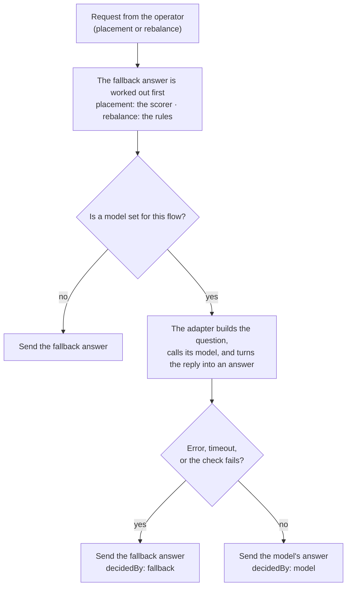

# Decision models: replace or add one

The [AI Decision Service](../ai-decision-service/README.md) makes two decisions:

- **Placement:** which node a new pod should go to.
- **Rebalance:** whether to change an app that is already running (move a pod, scale it, resize it, or leave it).

For each decision it can ask a **model**, such as Kev, an LLM or any other intelligence. The model plugs in through **one adapter file**. Everything around it is shared and stays as it is: the request from the operator, the safety check, the fallback answer and the decision log.

| I want to… | Read |
|---|---|
| Understand how a model fits in | [1. How it fits together](#1-how-it-fits-together) |
| Switch to another model, or turn one off | [2. Switch a model](#2-switch-a-model) |
| Plug in a new model or LLM | [3. Add a new model](#3-add-a-new-model) |
| Know exactly what an adapter gets and must return | [4. The adapter contract](#4-the-adapter-contract) |

## 1. How it fits together

Every decision, for either flow and with any model, goes the same way:



So a model can only make a decision better. A slow, broken or wrong model costs accuracy, never safety: its answer is checked, and the fallback answer is always ready.

**What you write, and what is already done:**

| You write, once per model | Already done, shared by every model |
|---|---|
| `model/<name>_model.go`: build the question or prompt, call the model, turn the reply into an answer | The request from the operator, with every fact the model needs |
| One `case` line per flow in `model/decider.go` | The fallback answer (the scorer, or the rules) |
| Its tests, and a page about it | The check on every answer, the timeout, the decision log, and the settings loader |

**Rule:** an adapter holds only what is specific to its model, such as its wording, prompt or API format. Safety rules live in the shared code, so they protect every model.

## 2. Switch a model

Switching to a model that already has an adapter (see [7. Current adapters](#7-current-adapters)) is **config only**. Each flow has its own five settings, so the two flows can use different models:

| Setting | Placement | Rebalance |
|---|---|---|
| Which adapter (`""` = no model) | `AI_DECISION_SERVICE_MODEL_PROVIDER` | `AI_DECISION_SERVICE_REBALANCE_MODEL_PROVIDER` |
| The model's address | `AI_DECISION_SERVICE_MODEL_BASE_URL` | `AI_DECISION_SERVICE_REBALANCE_MODEL_BASE_URL` |
| Its API path, added to the address | `AI_DECISION_SERVICE_MODEL_PATH` | `AI_DECISION_SERVICE_REBALANCE_MODEL_PATH` |
| The model name sent with each call | `AI_DECISION_SERVICE_MODEL_NAME` | `AI_DECISION_SERVICE_REBALANCE_MODEL_NAME` |
| Give up after this, then use the fallback | `AI_DECISION_SERVICE_MODEL_TIMEOUT` (5s) | `AI_DECISION_SERVICE_REBALANCE_MODEL_TIMEOUT` (30s) |

Each timeout must stay below the operator's own limit for that call: `DECISION_AGENT_TIMEOUT` (8s) for placement, and `REBALANCE_DECISION_TIMEOUT` (60s) for rebalance. That way the fallback can still answer in time.

**With Helm,** set them under `aiDecisionService.config` in `deploy/helm/hiro-adaptive-platform/values.yaml`, or on the command line:

```bash
helm upgrade hiro-adaptive-platform deploy/helm/hiro-adaptive-platform \
  -n hiro-adaptive-orchestrator-system --reuse-values \
  --set aiDecisionService.config.AI_DECISION_SERVICE_MODEL_PROVIDER=kev \
  --set aiDecisionService.config.AI_DECISION_SERVICE_MODEL_BASE_URL=http://host.docker.internal:8009 \
  --set aiDecisionService.config.AI_DECISION_SERVICE_MODEL_PATH=/v1/systemone \
  --set aiDecisionService.config.AI_DECISION_SERVICE_MODEL_NAME=kev-latest
```

The service restarts with the new values. A wrong or missing value stops it at startup with a clear error. To **turn a model off**, set its provider to `""`.

**Check that it worked:** every decision writes one log line with `decidedBy`.

```bash
kubectl logs -n hiro-adaptive-orchestrator-system deploy/ai-decision-service | grep '"msg":"Decision made"'
```

| `decidedBy` | Meaning |
|---|---|
| `model` | The model decided |
| `fallback` | The model failed. The warning line just before it (`Placement model failed…` or `Rebalance model failed…`) says why |
| `scorer` or `rules` | No model is set for that flow, or (rebalance) nothing could change |

## 3. Add a new model

Say the new model is called `example`. An adapter can serve placement, rebalance, or both.

### Step 1: write the adapter, `ai-decision-service/model/example_model.go`

```go
package model

// ProviderExample selects the Example model.
const ProviderExample = "example"

// ExampleDecider asks the Example model; it serves placement, rebalance, or both.
type ExampleDecider struct {
	cfg        Config
	scorerCfg  scorer.Config
	httpClient *http.Client
	log        *slog.Logger
}

// NewExampleDecider returns an ExampleDecider whose calls stop after cfg.Timeout.
func NewExampleDecider(cfg Config, scorerCfg scorer.Config, log *slog.Logger) *ExampleDecider {
	return &ExampleDecider{cfg: cfg, scorerCfg: scorerCfg, httpClient: &http.Client{Timeout: cfg.Timeout}, log: log}
}

// DecidePlacement scores every candidate node. Leave it out if the model doesn't do placement.
func (d *ExampleDecider) DecidePlacement(ctx context.Context,
	req placement.DecisionRequest) (placement.DecisionResponse, error) {
	// 1. Build the prompt from req (see 4.1).
	// 2. Call d.cfg.BaseURL + d.cfg.Path with ctx; d.httpClient stops after cfg.Timeout.
	// 3. Return one 0–100 score per candidate node, or an error.
}

// DecideRebalance proposes one rebalance action. Leave it out if the model doesn't do rebalance.
func (d *ExampleDecider) DecideRebalance(ctx context.Context, req placement.DecisionRequest,
	assessment rebalance.Assessment) (placement.RebalanceDecisionResponse, error) {
	// 1. Build the prompt from req.RebalanceContext and assessment.Blocked() (see 4.2).
	// 2. Call the model with ctx.
	// 3. Return one action, or an error.
}
```

`model/kev_model.go` is a complete working example for placement.

### Step 2: register it, in `ai-decision-service/model/decider.go`

Add one `case` to the factory of each flow it serves:

```go
// in New (placement)
	case ProviderExample:
		return NewExampleDecider(cfg, scorerCfg, log), nil

// in NewRebalance (rebalance)
	case ProviderExample:
		return NewExampleDecider(cfg, scorerCfg, log), nil
```

### Step 3: add any settings it needs
The five settings in section 2 cover most HTTP models. For anything more, such as an API key or a temperature, follow the repo rule that nothing is hard-coded:

1. Add a field to `model.Config`, and a `Default…` const, in `model/config.go`. Check it in `Validate`.
2. Read it in `cmd/main.go` → `envModelConfig`, so both flows get it with their own prefix.
3. Add it under `aiDecisionService.config` in the Helm values, and add a row to the [service README](../ai-decision-service/README.md#configuration) env table.
4. **Secrets:** the chart turns `aiDecisionService.config` into plain env values, so never put an API key there. Store it in a Kubernetes Secret, and add a `valueFrom.secretKeyRef` entry in `deploy/helm/hiro-adaptive-platform/templates/ai-decision-service/deployment.yaml`.

### Step 4: test it, in `model/example_model_test.go`
Copy the pattern in `model/kev_model_test.go`: a fake model server built with `httptest`.

| Case | Expected |
|---|---|
| A good reply | A valid answer (see section 4) |
| HTTP error, bad JSON, missing node, too slow | An error that names the request ID |

You don't need to test the fallback or the check: `server/server_test.go` already covers them for every model.

### Step 5: measure it, before switching
Run the model on labelled scenarios and judge each answer against the **strategy's purpose**, not against agreement with the fallback, which has known flaws.
- **Placement:** cover Balanced, Packed and Spread, 2 to 10 nodes, close calls, nodes over the limit, and zones.
- **Rebalance:** cover healthy apps (expect no change), down nodes, hot nodes, and apps that are too small or too big.

Record its latency, too.

### Step 6: try it on Kind, then switch
1. Deploy it, and set the provider (section 2).
2. Exercise it:
   - **Placement:** scale an app that has an `OrchestrationProfile`.
   - **Rebalance:** first set `spec.rebalancing.dryRun: true` on the profile, so the operator only reports what it would do. Turn it off once the answers hold up.
3. Read `decidedBy` in the log (section 2). When `model` is the norm and its answers hold up, make it the default in the Helm values.

### Step 7: document it
Add `model/example_model.md` next to the adapter, with its wiring, how it works, its measured accuracy, gaps and next steps, as `model/kev_model.md` does for Kev. Then add a row to [7. Current adapters](#7-current-adapters). Replacing a model later then means swapping its files and its `case` lines.

## 4. The adapter contract

**For both flows:**
- The request holds every fact. An adapter never calls the cluster.
- On anything it can't turn into a valid answer, it returns an **error**, never a guess. Name the request ID in it, e.g. `fmt.Errorf("(requestId=%s) …", req.RequestID)`. Any error sends the fallback answer.
- Leave `requestId` and `decidedBy` empty in the answer: the server sets them.

### 4.1 Placement: `DecidePlacement(ctx, req) (placement.DecisionResponse, error)`

| It gets (`placement.DecisionRequest`) | |
|---|---|
| `pod` | The pod to place, with its containers' requests |
| `aoProfile.strategy`, `aoProfile.awareness` | `Balanced` (default), `Packed` or `Spread`; which resources matter |
| `nodeStats[]` | One entry per node. **Only `candidate: true` nodes may be scored.** Each one has `resources` (`allocatable`, `requested`, live `used`; CPU in millicores, memory in bytes), `appPods`, `labels` (with the zone), `taints`, `conditions` and `imagesPresent`. A null value means unknown, never zero. |

| It returns (`placement.DecisionResponse`) | |
|---|---|
| `nodeScores` | **Exactly one** score per candidate and none for other nodes, each **0–100**, higher is better. A node that isn't allowed (`scorer.Allowed`) **must score 0**. |
| `reason` | Short text that starts with the strategy, e.g. `Packed: node-2 best (probability 0.83)` |
| `confidence` | 0–1, if the model gives one |

**Helpers** (`scorer/`), so the adapter sees the same numbers as the scorer:

| Helper | Gives |
|---|---|
| `scorer.Strategy`, `scorer.PodRequests`, `scorer.ScoredResources` | The strategy, the pod's requests, and the resources that matter |
| `scorer.Utilization(node, pod, resources)` | Each resource's share, with the pod placed and live usage counted |
| `scorer.Allowed(util, strategy, cfg)` | Whether the node may take the pod at all |
| `scorer.MaxUtil`, `scorer.Average`, `scorer.CountAppPodsPerZone` | The busiest share, the average share, and this app's pods per zone |

### 4.2 Rebalance: `DecideRebalance(ctx, req, assessment) (placement.RebalanceDecisionResponse, error)`

| It gets (`req.RebalanceContext`) | |
|---|---|
| `currentPlacements[]` | Each pod of the app: its node, phase and containers (requests, limits, live `cpuUsed` / `memoryUsed`) |
| `trigger` | What started this review, e.g. a node failure or CPU pressure, with its value and threshold |
| `workload` | `replicas`, `minReplicas`, `maxReplicas` and `improvementThreshold` |
| `pdb`, `history`, `cooldownUntil` | The disruption budget, recent decisions, and the cooldown |
| `nodeStats[]` | As for placement. The app's nodes that can't take pods are listed with `candidate: false`. |

| It returns (`placement.RebalanceDecisionResponse`) | |
|---|---|
| `action` | `NoOp`, `Move`, `AdjustReplicas`, `AdjustResources`, `Defer`, `Reject` or `Escalate` |
| `podName`, `targetNode` | For Move: a pod from `currentPlacements`, and a healthy candidate |
| `targetReplicas` | For AdjustReplicas: the new count, not a difference |
| `containerName`, `targetCpu`, `targetMemory` | For AdjustResources: Kubernetes quantities, e.g. `500m`, `512Mi` |
| `improvement` | The expected gain. The operator carries out Move, AdjustReplicas and AdjustResources only when it reaches `workload.improvementThreshold`. |
| `reason`, `confidence` | Short text for the profile's status and events; 0–1, if known |

**Helpers** (`assessment`, worked out by the shared rules):

| Helper | Gives |
|---|---|
| `assessment.Blocked()` | What is blocked right now, in words, for a question or prompt |
| `assessment.Check(answer)` | Why an answer would be rejected, or `""`; use it to drop options before asking |
| `assessment.RulesAnswer(scorerCfg)` | The rules' answer, which an adapter may return as its own, e.g. for a pod on a down node |

## 5. What the check rejects

The server checks every model's answer before sending it. A rejected answer is never sent: the fallback answer goes out instead.

| Placement rejects an answer when | Rebalance rejects an answer when |
|---|---|
| A candidate has no score, or two | A gate blocks it: a cooldown; replicas or resources another controller manages; a PDB with no disruptions left (Move); a fresh energy hold (anything that starts pods); or a recent Move (churn, ping-pong) |
| A node that isn't a candidate is scored | A Move names a pod that isn't in the request or isn't scheduled, its own node, or a target that isn't a healthy candidate |
| A score is outside 0–100, or is NaN | AdjustReplicas goes outside min..max, or keeps the same count |
| A node that isn't allowed (the pod doesn't fit, or a Packed node would go over `AI_DECISION_SERVICE_SCORER_PACKED_MAX_UTIL`) scores above 0 | AdjustResources names an unknown container, or has no target, or a target that isn't a positive quantity |
| | It skips the **must-do**: while a pod is on a down node and a healthy node can take it, the answer must move a pod off a down node |

The code is `checkPlacementAnswer` in `server/server.go` for placement, and `Assessment.Check` in `rebalance/rules.go` for rebalance. For rebalance, the model isn't asked at all when nothing can change: a cooldown with no pod on a down node.

## 6. Before you go live

- [ ] Every answer meets [section 4](#4-the-adapter-contract), and every failure returns an error that names the request ID.
- [ ] Every new setting has a default, an env var, a Helm value and a README row. Secrets come from a Secret.
- [ ] Each timeout stays below the operator's limit for that call (section 2).
- [ ] `make test-ai-decision-service` and `make lint` pass.
- [ ] It's measured on labelled scenarios (step 5), with the results in its `model/<name>_model.md`.
- [ ] It's tried on Kind (step 6), with `decidedBy: model` in the log, and rebalance tried with `dryRun` first.

## 7. Current adapters

| Flow | Provider | Adapter | Details |
|---|---|---|---|
| Placement | `kev` | `model/kev_model.go` | [model/kev_model.md](../ai-decision-service/model/kev_model.md): wiring, how it works, accuracy, gaps, next steps |
| Rebalance | none yet | | The rules answer |
