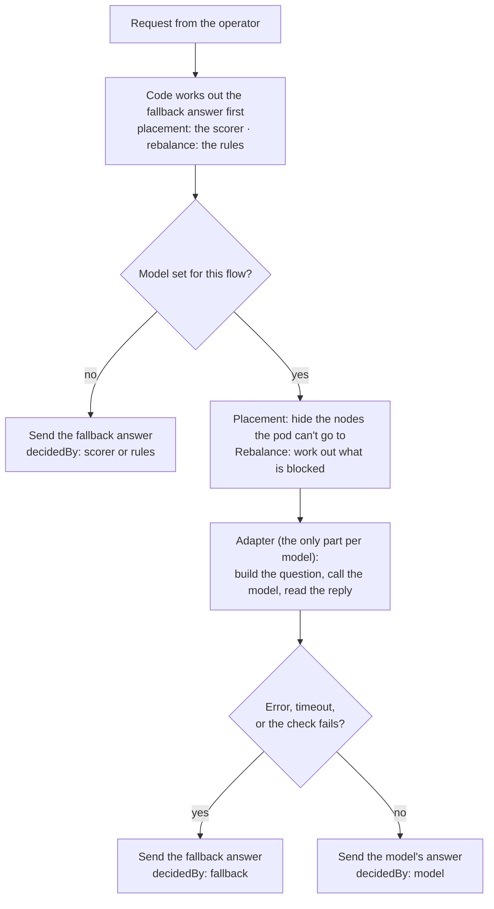

# Decision models: use, replace or add one

The [AI Decision Service](../ai-decision-service/README.md) makes two decisions:

- **Placement:** which node a new pod goes to.
- **Rebalance:** whether to change a running app: move a pod, scale it, resize it, or leave it.

For each one it can ask a **model**: Kev, an LLM or any other intelligence. Models are **off by default**, and then code decides: the scorer for placement, the rules for rebalance.

## What changes for a new model

| Your model | What you change | How |
|---|---|---|
| Kev, at any version or address | Settings only | [2. Switch a model](#2-switch-a-model) |
| An LLM with an OpenAI-style API: OpenAI, Gemini, Mistral, Groq, vLLM, Ollama… | Settings only, through the built-in `openai-compatible` adapter *(next step, not built yet)* | [2. Switch a model](#2-switch-a-model) |
| Claude, Bedrock or Vertex through their own APIs | Settings only, with a gateway such as LiteLLM in front, then as the row above *(next step)* | [2. Switch a model](#2-switch-a-model) |
| A model with its own, non-OpenAI API, like Kev's | One adapter file, which is rare | [3. Add a model with its own API](#3-add-a-model-with-its-own-api-rare) |

Nothing else changes for any model. The operator, the request, the safety check, the fallback answer and the decision log are shared.

## 1. How it fits together



Every safety rule sits outside the adapter, so a slow, broken or wrong model costs accuracy, never safety.

## 2. Switch a model

For a model that already has an adapter (see [6. Current adapters](#6-current-adapters)), you only change settings. Each flow has its own, so the two flows can use different models.

| Setting | Placement | Rebalance |
|---|---|---|
| Which adapter; empty means off | `AI_DECISION_SERVICE_MODEL_PROVIDER` | `AI_DECISION_SERVICE_REBALANCE_MODEL_PROVIDER` |
| The model's address (below) | `AI_DECISION_SERVICE_MODEL_BASE_URL` | `AI_DECISION_SERVICE_REBALANCE_MODEL_BASE_URL` |
| Its API path, added to the address | `AI_DECISION_SERVICE_MODEL_PATH` | `AI_DECISION_SERVICE_REBALANCE_MODEL_PATH` |
| The model name sent with each call | `AI_DECISION_SERVICE_MODEL_NAME` | `AI_DECISION_SERVICE_REBALANCE_MODEL_NAME` |
| API key for a hosted model; empty means none (below) | `AI_DECISION_SERVICE_MODEL_API_KEY` | `AI_DECISION_SERVICE_REBALANCE_MODEL_API_KEY` |
| Give up after this, and use the fallback | `AI_DECISION_SERVICE_MODEL_TIMEOUT` (5s) | `AI_DECISION_SERVICE_REBALANCE_MODEL_TIMEOUT` (30s) |

Keep each timeout below the operator's limit for that call, so the fallback can still answer in time: `DECISION_AGENT_TIMEOUT` (8s) for placement, `REBALANCE_DECISION_TIMEOUT` (60s) for rebalance.

**The address** is the model's URL as seen from inside the cluster:

| The model runs | Address |
|---|---|
| In the cluster | Its Service, e.g. `http://kev.<namespace>.svc:8009` |
| Anywhere else on the network | Its URL |
| On your machine, with Kind on Docker Desktop (macOS, Windows) | `http://host.docker.internal:<port>` |
| On your machine, with Kind on Linux | `http://<gateway>:<port>`, where `<gateway>` is the IPv4 `Gateway` from `docker network inspect kind` |

A model on your machine must listen on all interfaces, not only `localhost`.

**The API key**, only for a hosted model, always comes from a Kubernetes Secret, never from `aiDecisionService.config`:

```bash
kubectl create secret generic llm-api-key -n hiro-adaptive-orchestrator-system --from-literal=api-key=<your-key>
# then, with Helm:
--set aiDecisionService.modelApiKeySecret.name=llm-api-key            # placement
--set aiDecisionService.rebalanceModelApiKeySecret.name=llm-api-key   # rebalance
```

**Turn it on.** For example, Kev for placement. With Helm:

```bash
helm upgrade hiro-adaptive-platform deploy/helm/hiro-adaptive-platform \
  -n hiro-adaptive-orchestrator-system --reuse-values \
  --set aiDecisionService.config.AI_DECISION_SERVICE_MODEL_PROVIDER=kev \
  --set aiDecisionService.config.AI_DECISION_SERVICE_MODEL_BASE_URL=http://<kev-address>:8009 \
  --set aiDecisionService.config.AI_DECISION_SERVICE_MODEL_PATH=/v1/systemone \
  --set aiDecisionService.config.AI_DECISION_SERVICE_MODEL_NAME=kev-latest
```

With the Kind script, pass the same settings when you run it:

```bash
AI_DECISION_SERVICE_MODEL_PROVIDER=kev \
AI_DECISION_SERVICE_MODEL_BASE_URL=http://<kev-address>:8009 \
AI_DECISION_SERVICE_MODEL_PATH=/v1/systemone \
AI_DECISION_SERVICE_MODEL_NAME=kev-latest \
deploy/scripts/deploy_full_stack_with_helm.sh
```

To **turn it off**, set the provider to `""`. A wrong or missing setting stops the service at startup with a clear error.

**Check that it works.** Every decision writes one log line with `decidedBy`:

```bash
kubectl logs -n hiro-adaptive-orchestrator-system deploy/ai-decision-service | grep '"msg":"Decision made"'
```

| `decidedBy` | Meaning |
|---|---|
| `model` | The model decided |
| `fallback` | The model failed. The warning line just before it (`Placement model failed…` or `Rebalance model failed…`) says why |
| `scorer` or `rules` | No model is set for that flow, or nothing was left to ask it |

## 3. Add a model with its own API (rare)

Only for a model whose API isn't OpenAI-style and has no adapter yet, as Kev's System One API needed. An OpenAI-style LLM needs no code: see [2. Switch a model](#2-switch-a-model).

Say the new model is called `example`:

| Step | What you do | File |
|---|---|---|
| 1 | Write the adapter: build the question, call the model, read the reply | `ai-decision-service/model/example_model.go` (new) |
| 2 | Register it: one `case` line per flow it serves | `ai-decision-service/model/decider.go` |
| 3 | Add settings, only if the six in section 2 aren't enough | `model/config.go`, `cmd/main.go`, Helm values |
| 4 | Test it against a fake model server | `ai-decision-service/model/example_model_test.go` (new) |
| 5 | Measure it, try it on Kind, then switch to it | — |
| 6 | Document it, and add it to [6. Current adapters](#6-current-adapters) | `ai-decision-service/model/example_model.md` (new) |

### Step 1: write the adapter

An adapter can serve placement, rebalance or both. [`model/kev_model.go`](../ai-decision-service/model/kev_model.go) is a complete example for placement.

```go
package model

// ProviderExample selects the Example model.
const ProviderExample = "example"

// ExampleDecider asks the Example model.
type ExampleDecider struct {
	cfg        Config
	scorerCfg  scorer.Config
	httpClient *http.Client
	log        *slog.Logger
}

func NewExampleDecider(cfg Config, scorerCfg scorer.Config, log *slog.Logger) *ExampleDecider {
	return &ExampleDecider{cfg: cfg, scorerCfg: scorerCfg, httpClient: &http.Client{Timeout: cfg.Timeout}, log: log}
}

// DecidePlacement scores every candidate node. Leave it out if the model doesn't do placement.
func (d *ExampleDecider) DecidePlacement(ctx context.Context,
	req placement.DecisionRequest) (placement.DecisionResponse, error) {
	// 1. Build the question from req (section 4.1).
	// 2. POST it to d.cfg.BaseURL + d.cfg.Path with ctx.
	// 3. Return one 0–100 score per candidate, or an error.
}

// DecideRebalance picks one action. Leave it out if the model doesn't do rebalance.
func (d *ExampleDecider) DecideRebalance(ctx context.Context, req placement.DecisionRequest,
	assessment rebalance.Assessment) (placement.RebalanceDecisionResponse, error) {
	// 1. Build the question from req.RebalanceContext and assessment.Blocked() (section 4.2).
	// 2. POST it to the model with ctx.
	// 3. Return one action, or an error.
}
```

### Step 2: register it

```go
// in New (placement)
	case ProviderExample:
		return NewExampleDecider(cfg, scorerCfg, log), nil

// in NewRebalance (rebalance)
	case ProviderExample:
		return NewExampleDecider(cfg, scorerCfg, log), nil
```

### Step 3: add settings, only if needed

For anything beyond the six settings in section 2, nothing is hard-coded:

1. A field and a `Default…` const in `model/config.go`, checked in `Validate`.
2. Read it in `cmd/main.go` → `envModelConfig`, so each flow gets it with its own prefix.
3. A Helm value under `aiDecisionService.config`, and a row in the [service README](../ai-decision-service/README.md#configuration).
4. **A secret goes in a Kubernetes Secret, never in `aiDecisionService.config`**, which becomes plain env values. Copy how the API key does it: `modelApiKeySecret` in the Helm values and `deploy/helm/hiro-adaptive-platform/templates/ai-decision-service/deployment.yaml`, and `json:"-"` on its field so the startup log never prints it.

### Step 4: test it

Copy [`model/kev_model_test.go`](../ai-decision-service/model/kev_model_test.go): a fake model server built with `httptest`.

| Case | Expected |
|---|---|
| A good reply | An answer as in section 4 |
| HTTP error, bad JSON, a missing node, too slow | An error that names the request ID |

The fallback and the check are already tested for every model in `server/server_test.go`.

### Step 5: measure it, try it, switch

1. **Measure** on labelled scenarios, judged against each strategy's purpose, not against the fallback. Placement: Balanced, Packed and Spread, 2 to 10 nodes, close calls, zones. Rebalance: healthy apps, down nodes, hot nodes, apps too small or too big. Record the latency.
2. **Try it on Kind:** turn it on (section 2). For placement, scale an app that has an `OrchestrationProfile`. For rebalance, first set `spec.rebalancing.dryRun: true` on the profile, so the operator only reports what it would do.
3. **Switch** when `decidedBy: model` is the norm in the log and its answers hold up.

### Step 6: document it

Add `model/example_model.md` next to the adapter, with its settings, how it works, its measured accuracy, gaps and next steps, like [kev_model.md](../ai-decision-service/model/kev_model.md). Then add a row to [6. Current adapters](#6-current-adapters).

## 4. What an adapter gets and returns

**For both flows:**
- The request holds every fact. An adapter never calls the cluster.
- If it can't make a valid answer, it returns an **error**, never a guess, and names the request ID: `fmt.Errorf("(requestId=%s) …", req.RequestID)`. Any error sends the fallback answer.
- Leave `requestId` and `decidedBy` empty. The service sets them.

### 4.1 Placement: `DecidePlacement(ctx, req)`

It gets a `placement.DecisionRequest`:

| Field | |
|---|---|
| `pod` | The pod to place, with its containers' requests |
| `aoProfile.strategy`, `aoProfile.awareness` | `Balanced` (default), `Packed` or `Spread`; which resources matter |
| `nodeStats[]` | One entry per node. Score only the `candidate: true` ones. Each has `resources` (`allocatable`, `requested`, live `used`; CPU in millicores, memory in bytes), `appPods`, `labels` (with the zone), `taints`, `conditions` and `imagesPresent`. A null value means unknown, never zero. |

**Only nodes the pod can go to are candidates.** The service has already hidden the nodes it doesn't fit on, or that would go over the Packed limit, and scores them 0 itself. If no node is left, it doesn't ask the model at all.

It returns a `placement.DecisionResponse`:

| Field | |
|---|---|
| `nodeScores` | Exactly one score per candidate, each 0–100, higher is better |
| `reason` | Short text that starts with the strategy, e.g. `Packed: node-2 best (probability 0.83)` |
| `confidence` | 0–1, if the model gives one |

Helpers in `scorer/`, so the adapter sees the same numbers as the scorer:

| Helper | Gives |
|---|---|
| `scorer.Strategy`, `scorer.PodRequests`, `scorer.ScoredResources` | The strategy, the pod's requests, and the resources that matter |
| `scorer.Utilization(node, pod, resources)` | Each resource's share with the pod placed, counting live usage |
| `scorer.MaxUtil`, `scorer.Average`, `scorer.CountAppPodsPerZone` | The busiest share, the average share, and this app's pods per zone |

### 4.2 Rebalance: `DecideRebalance(ctx, req, assessment)`

It gets `req.RebalanceContext`:

| Field | |
|---|---|
| `currentPlacements[]` | Each pod of the app: its node, phase and containers (requests, limits, live `cpuUsed` / `memoryUsed`) |
| `trigger` | What started this review, e.g. a node failure or CPU pressure, with its value and threshold |
| `workload` | `replicas`, `minReplicas`, `maxReplicas` and `improvementThreshold` |
| `pdb`, `history`, `cooldownUntil` | The disruption budget, recent decisions, and the cooldown |
| `nodeStats[]` | As for placement. Nodes that can't take pods have `candidate: false`. |

And `assessment`, worked out by the shared rules:

| Helper | Gives |
|---|---|
| `assessment.Blocked()` | What is blocked right now, in words, to put in the question |
| `assessment.Check(answer)` | Why an answer would be rejected, or `""` |
| `assessment.RulesAnswer(scorerCfg)` | The rules' answer, which an adapter may return as its own |

It returns a `placement.RebalanceDecisionResponse`:

| Field | |
|---|---|
| `action` | `NoOp`, `Move`, `AdjustReplicas`, `AdjustResources`, `Defer`, `Reject` or `Escalate` |
| `podName`, `targetNode` | Move: a pod from `currentPlacements`, and a healthy candidate |
| `targetReplicas` | AdjustReplicas: the new count, not a difference |
| `containerName`, `targetCpu`, `targetMemory` | AdjustResources: Kubernetes quantities, e.g. `500m`, `512Mi` |
| `improvement` | The expected gain. The operator carries out a Move, AdjustReplicas or AdjustResources only when it reaches `workload.improvementThreshold`. |
| `reason`, `confidence` | Short text for the profile's status and events; 0–1, if known |

## 5. What the service checks, for every model

Every answer is checked before it's sent. A rejected answer is never sent; the fallback answer goes instead.

| Placement: rejected when | Rebalance: rejected when |
|---|---|
| A candidate has no score, or two | A gate blocks it: a cooldown; replicas or resources another controller manages; a PDB with no disruptions left (Move); a fresh energy hold (anything that starts pods); a recent Move (churn, ping-pong) |
| A node that isn't a candidate is scored | A Move names a pod that isn't in the request or isn't scheduled, its own node, or a target that isn't a healthy candidate |
| A score is outside 0–100, or is NaN | AdjustReplicas goes outside min..max, or keeps the same count |
| | AdjustResources names an unknown container, has no target, or a target that isn't a positive quantity |
| | It skips the **must-do**: while a pod is on a down node and a healthy node can take it, the answer must move a pod off a down node |

Before asking, the service also leaves out what no model may choose: placement hides the nodes the pod can't go to, and rebalance doesn't ask at all during a cooldown with no pod on a down node.

The code: `placementAnswer` and `checkPlacementAnswer` in `server/server.go`; `Assessment.Check` in `rebalance/rules.go`.

## 6. Current adapters

| Flow | Provider | Adapter | Details |
|---|---|---|---|
| Placement | `kev` | `model/kev_model.go` | [kev_model.md](../ai-decision-service/model/kev_model.md): settings, how it works, accuracy, gaps, next steps |
| Placement and rebalance | `openai-compatible` | *Next step, not built yet* | Any LLM with an OpenAI-style API, settings only |
| Rebalance, today | none | | The rules answer |
