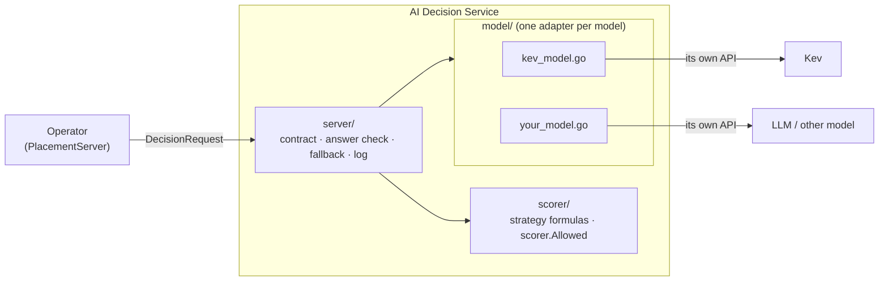
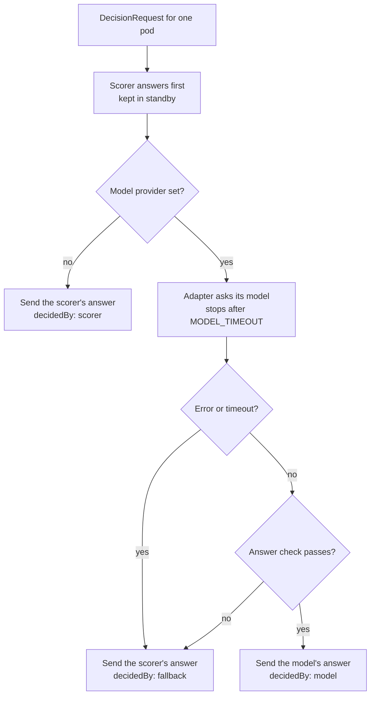

# Decision models: switching or adding one

The [AI Decision Service](../ai-decision-service/README.md) can ask a **model** where to place each new pod. The model can be Kev, an LLM, or any other intelligence. It is a plug-in:

- **Switching** between models that already have an adapter is **config only**.
- **Adding** a new model is **one Go file plus one line**.
- Everything else stays as it is: the contract with the operator, the safety rule, the answer check, the fallback and the decision log.

This guide covers placement. Rebalance doesn't use a model yet.

## 1. What stays and what is per model



| Part | Same for every model | What it does |
|---|---|---|
| `server/` | yes | Takes the request, asks the model, checks the answer, falls back to the scorer, writes one log line |
| `scorer/` | yes | The fallback answer, and the hard rule `scorer.Allowed` (the pod must fit; Packed stays under its limit) |
| `model/decider.go` | yes | The `PlacementDecider` interface and the `model.New` factory that picks an adapter by provider name |
| `model/<name>_model.go` | **no, one per model** | Turns the request into that model's question or prompt, and its reply into node scores |

**Rule:** an adapter holds only what is specific to its model (wording, prompt, API format). System rules live in `scorer/` or `server/`, so they protect every model.

## 2. How one placement decision flows



**The answer check** in `server/server.go` (`checkPlacementAnswer`) rejects an answer when:
- a candidate node has no score, or has two
- a node that isn't a candidate is scored
- a score is outside 0–100, or is NaN
- a node that isn't allowed (`scorer.Allowed`: the pod doesn't fit, or a Packed node would go over `AI_DECISION_SERVICE_SCORER_PACKED_MAX_UTIL`) has a score above 0

A rejected answer is never sent. The scorer's answer goes out instead, so a bad model can cost accuracy but never safety.

**Timeouts** are nested, so the scorer can always answer in time:

```text
operator → AI Decision Service : DECISION_AGENT_TIMEOUT             (operator, default 8s)
service  → model               : AI_DECISION_SERVICE_MODEL_TIMEOUT  (default 5s)  ← must stay below the one above
```

Placement runs for every new pod, so a model that needs several seconds slows every pod start. Pick the timeout from measured latency.

## 3. Switch to a model that already has an adapter

| Env var | Meaning |
|---|---|
| `AI_DECISION_SERVICE_MODEL_PROVIDER` | Which adapter: `""` = no model (the scorer answers), `kev` = Kev |
| `AI_DECISION_SERVICE_MODEL_BASE_URL` | The model's address, e.g. `http://host.docker.internal:8009` |
| `AI_DECISION_SERVICE_MODEL_PATH` | The API path, appended to the base URL |
| `AI_DECISION_SERVICE_MODEL_NAME` | Model name sent with each call |
| `AI_DECISION_SERVICE_MODEL_TIMEOUT` | Give up after this, and the scorer answers |

With Helm, set them under `aiDecisionService.config` in `deploy/helm/hiro-adaptive-platform/values.yaml`, or on the command line:

```bash
helm upgrade hiro-adaptive-platform deploy/helm/hiro-adaptive-platform \
  -n hiro-adaptive-orchestrator-system --reuse-values \
  --set aiDecisionService.config.AI_DECISION_SERVICE_MODEL_PROVIDER=kev \
  --set aiDecisionService.config.AI_DECISION_SERVICE_MODEL_BASE_URL=http://host.docker.internal:8009 \
  --set aiDecisionService.config.AI_DECISION_SERVICE_MODEL_PATH=/v1/systemone \
  --set aiDecisionService.config.AI_DECISION_SERVICE_MODEL_NAME=kev-latest
```

The Deployment rolls out with the new values. A wrong or missing value stops the service at startup with a clear error.

**Turn the model off** with `AI_DECISION_SERVICE_MODEL_PROVIDER=""`. The scorer then answers every request.

## 4. Add a new model

Say the new model is called `example`.

### Step 1: write the adapter, `ai-decision-service/model/example_model.go`

```go
package model

// ProviderExample selects the Example model.
const ProviderExample = "example"

// ExampleDecider asks the Example model where to place a pod.
type ExampleDecider struct {
	cfg        Config
	scorerCfg  scorer.Config
	httpClient *http.Client
	log        *slog.Logger
}

var _ PlacementDecider = (*ExampleDecider)(nil) // the build fails if it stops matching the interface

// NewExampleDecider returns an ExampleDecider whose calls stop after cfg.Timeout.
func NewExampleDecider(cfg Config, scorerCfg scorer.Config, log *slog.Logger) *ExampleDecider {
	return &ExampleDecider{cfg: cfg, scorerCfg: scorerCfg, httpClient: &http.Client{Timeout: cfg.Timeout}, log: log}
}

// DecidePlacement asks the Example model to score every candidate node.
func (d *ExampleDecider) DecidePlacement(ctx context.Context,
	req placement.DecisionRequest) (placement.DecisionResponse, error) {
	// 1. Build the prompt from req, using the scorer helpers below.
	// 2. Call d.cfg.BaseURL + d.cfg.Path with ctx; d.httpClient stops after cfg.Timeout.
	// 3. Turn the reply into one 0–100 score per candidate node (see the contract below).
	// 4. On anything you can't turn into a valid answer, return an error: the scorer answers instead.
}
```

### Step 2: register it, in `model/decider.go` → `New`

```go
	case ProviderExample:
		return NewExampleDecider(cfg, scorerCfg, log), nil
```

### Step 3: add any settings it needs
The existing `model.Config` (provider, base URL, path, model name, timeout) covers most HTTP models. For anything more, such as an API key or a temperature, follow the repo rule that nothing is hard-coded:

1. Add a field to `model.Config`, and a `Default…` const in `model/config.go`. Check it in `Validate`.
2. Read it from an env var in `cmd/main.go` → `loadConfig`, using the `AI_DECISION_SERVICE_MODEL_` prefix.
3. Add the value under `aiDecisionService.config` in the Helm values, and a row in the [service README](../ai-decision-service/README.md#configuration) env table.
4. **Secrets:** the chart turns `aiDecisionService.config` into plain env values. Never put an API key there. Store it in a Kubernetes Secret, and add a `valueFrom.secretKeyRef` env entry in `deploy/helm/hiro-adaptive-platform/templates/ai-decision-service/deployment.yaml`.

### Step 4: tests, in `model/example_model_test.go`
Copy the pattern in `model/kev_model_test.go`: a fake model server built with `httptest`, plus these cases:

| Case | Expected |
|---|---|
| good reply | one score per candidate, in 0–100 |
| node that isn't allowed | scored 0, or left out of the prompt and scored 0 |
| HTTP error, bad JSON, missing node, too slow, no candidates | an error (the request ID in the message) |

The server's fallback and answer check are already tested in `server/server_test.go` with a stub decider, so you don't repeat them.

### Step 5: measure before switching
Run the model on labelled scenarios and judge every answer against the **strategy's purpose**. Don't count agreement with the scorer as success, because the scorer has known flaws. Cover:
- Balanced, Packed and Spread
- 2 to 10 nodes
- close calls
- nodes over the limit
- zones

Compare the model with the current model and with the scorer, and record its latency at 2, 5 and 10 nodes.

### Step 6: try it on Kind, then switch
1. Deploy it, set the provider (section 3), and scale an app that has an `OrchestrationProfile`.
2. Read the decision log:
   ```bash
   kubectl logs -n hiro-adaptive-orchestrator-system deploy/ai-decision-service | grep '"flow":"placement"'
   ```
   Each line has `decidedBy`. If you see `fallback`, the warning line `Placement model failed, scorer will be used instead` just before it gives the reason.
3. When `decidedBy: model` is the norm and its picks hold up, make it the default in the Helm values.

### Step 7: document it
Add `model/example_model.md` next to the adapter: its wiring, how it works, its measured accuracy, gaps and next steps. Add a row to the table below. Replacing a model then means swapping its adapter files and its `case`.

## 5. The adapter contract

**Input:** `placement.DecisionRequest` (`pkg/placement/decision.go`). The request holds every fact; an adapter never calls the cluster.

| Field | What it holds |
|---|---|
| `Pod` | The pod to place, with its containers' requests |
| `AOProfile.Strategy` | `Balanced` (default), `Packed` or `Spread` |
| `AOProfile.Awareness` | Which resources matter (CPU, memory, GPU, energy) |
| `NodeStats[]` | One entry per node. **Only `Candidate: true` nodes may be scored.** Each one has `resources` (`allocatable`, `requested`, live `used`; CPU in millicores, memory in bytes), `appPods` (this app's pods on the node), `labels` (including the zone), `taints`, `conditions`, `imagesPresent`, and `energy` (null until per-node energy data exists). A null value means unknown, never zero. |
| `EAOProfile` | Energy-aware orchestrator data, when energy awareness is on |

**Output:** `placement.DecisionResponse`

| Field | Rule |
|---|---|
| `NodeScores` | **Exactly one** score per candidate and none for other nodes, each in **0–100**, where higher is better. A node that isn't allowed **must score 0**. |
| `Reason` | Short text that starts with the strategy, e.g. `Packed: node-2 best (probability 0.83)` |
| `Confidence` | 0–1, if the model gives one |
| `RequestID`, `DecidedBy` | Leave empty: the server sets them |

**Errors:** return an error, never a guess. Include the request ID, e.g. `fmt.Errorf("(requestId=%s) …", req.RequestID)`. Any error sends the scorer's answer.

**Helpers from `scorer/`,** so the adapter sees the same numbers as the scorer:

| Helper | Gives |
|---|---|
| `scorer.Strategy(req.AOProfile)` | The strategy, with Balanced as the default |
| `scorer.PodRequests(req.Pod)` | The pod's CPU (millicores) and memory (bytes) requests |
| `scorer.ScoredResources(req.AOProfile)` | The resources the profile cares about |
| `scorer.Utilization(node, pod, resources)` | Each resource's share, with the pod placed and live usage counted. `ok` is false when unknown. |
| `scorer.Allowed(util, strategy, cfg)` | Whether the node may take the pod at all |
| `scorer.MaxUtil(util)`, `scorer.Average(util)` | The busiest share, and the average share |
| `scorer.CountAppPodsPerZone(nodes, cfg).ZoneCounts` | This app's pods per zone, over all nodes |

## 6. Before you go live

- [ ] The adapter scores every candidate once, in 0–100, and scores nodes that aren't allowed 0.
- [ ] Every failure returns an error that includes the request ID.
- [ ] Every new setting has a default, an env var, a Helm value and a README row. Secrets come from a Secret.
- [ ] `AI_DECISION_SERVICE_MODEL_TIMEOUT` stays below the operator's `DECISION_AGENT_TIMEOUT`.
- [ ] `make test-ai-decision-service` and `make lint` pass.
- [ ] Measured on the labelled scenarios (step 5), with the results in `model/<name>_model.md`.
- [ ] Tried on Kind, and `decidedBy: model` shows in the decision log.

## 7. Current adapters

| Provider | Adapter | Details |
|---|---|---|
| `kev` | `model/kev_model.go` | [model/kev_model.md](../ai-decision-service/model/kev_model.md): wiring, how it works, accuracy, gaps, next steps |
