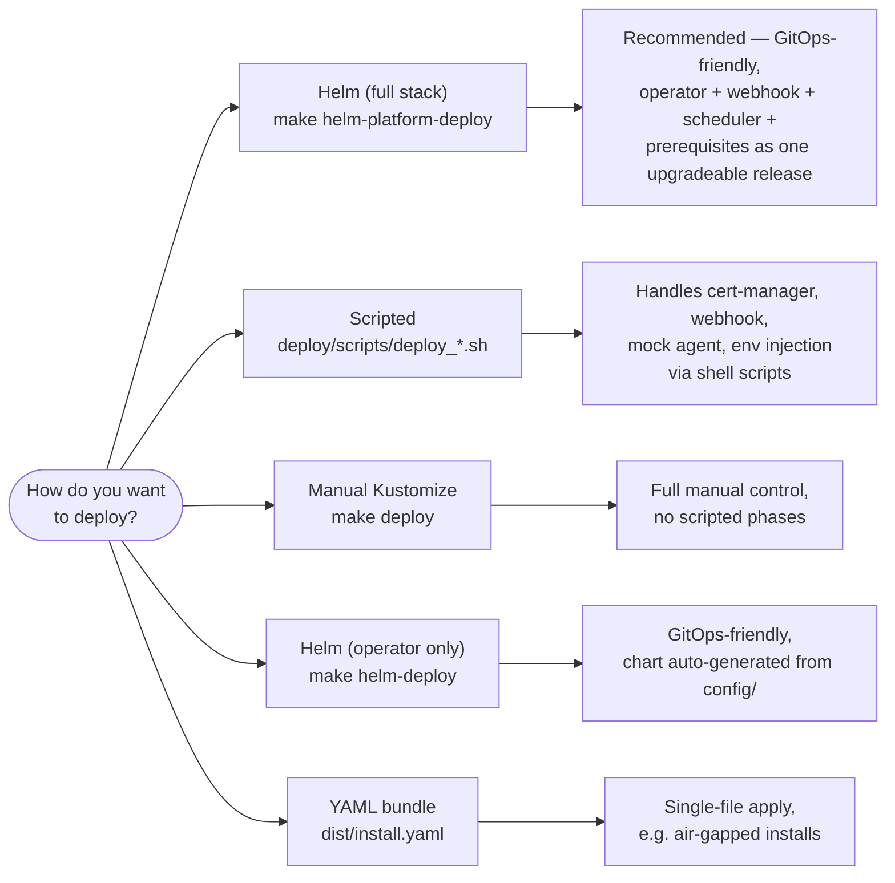
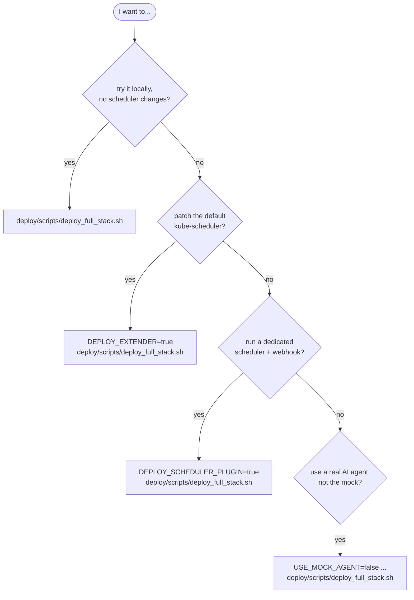
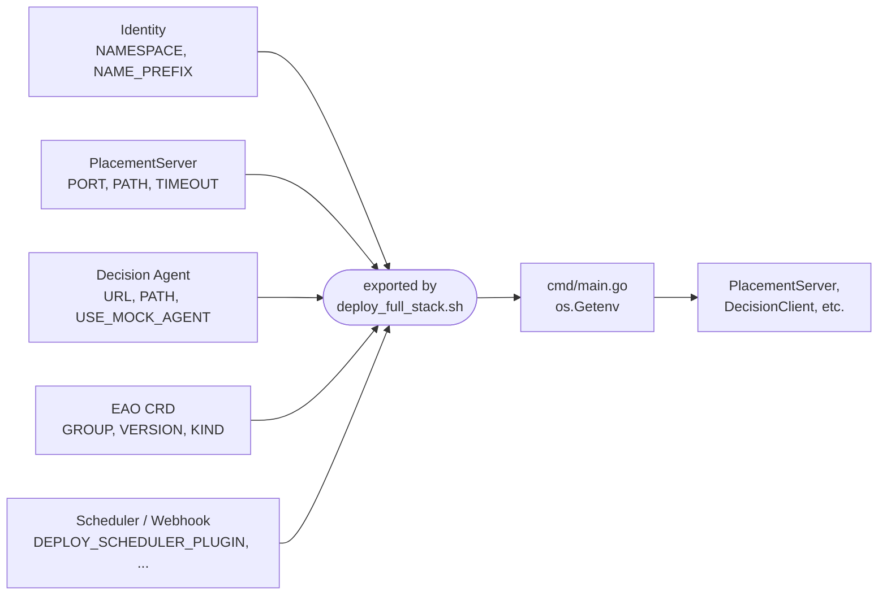
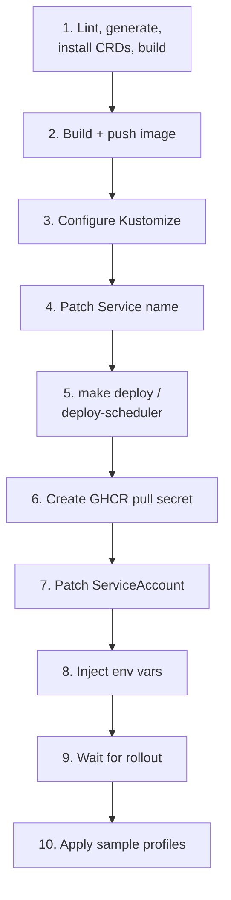
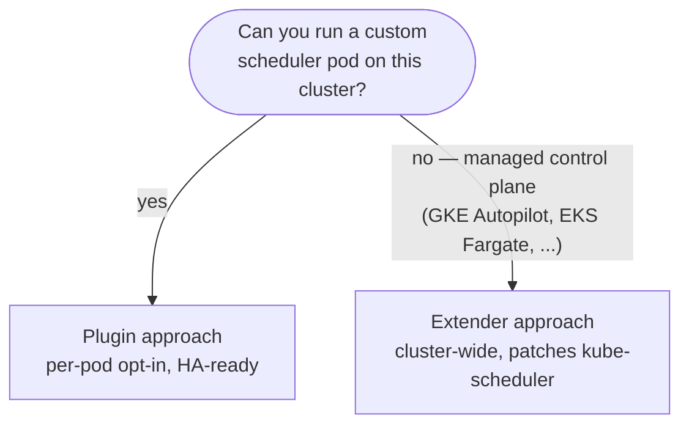
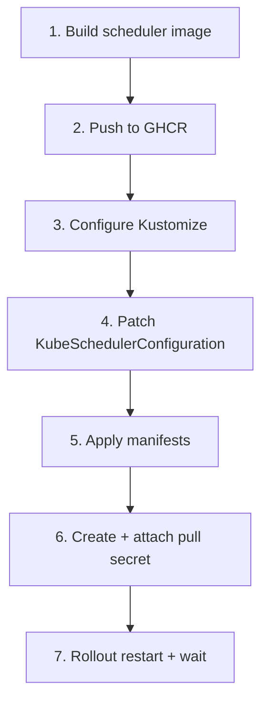
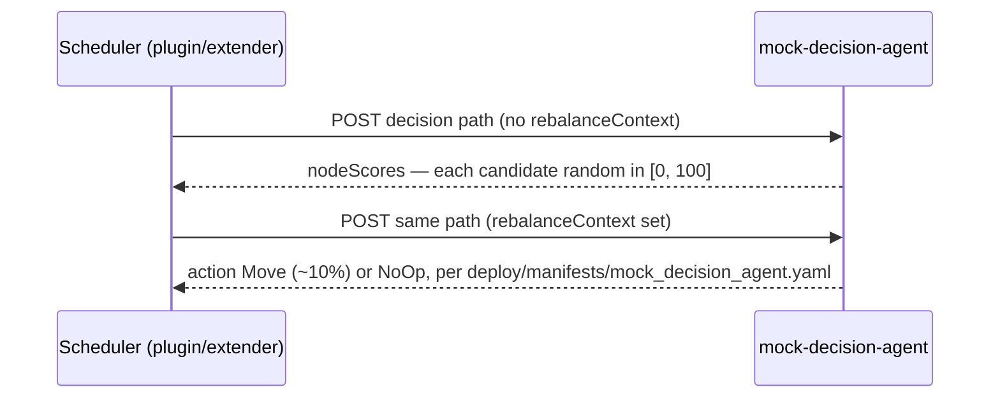

# Deployment

Every way to deploy this project: the recommended Helm umbrella chart, the shell-script full stack, and every standalone single-component path (operator only, scheduler only, extender only, mock agent, manual Kustomize, YAML bundle), plus the full parameter reference.

Referenced from the main [README's Quick Start](../README.md#quick-start), which only covers the single recommended command — this file has the full detail.



All deploy scripts and charts share the same parameter model: every variable has a default and can be overridden via environment.

---

## Full-Stack via Helm — umbrella chart (recommended)

```bash
deploy/scripts/deploy_full_stack_with_helm.sh [deploy|clean|destroy]
```

| Action | Effect |
|--------|--------|
| `deploy` (default) | Build images, load into Kind, deploy in one Helm run, health-check |
| `clean` | Uninstall the Helm release, keep the Kind cluster |
| `destroy` | Delete the Kind cluster |

Prefer `clean` over `destroy` in extender mode: the chart's kube-scheduler restore Job is a
`pre-delete` hook, so only a Helm uninstall reverts the patch. The `OrchestrationProfile` CRD is
annotated `helm.sh/resource-policy: keep`, so it and any profiles you created survive a `clean`.

Deploys everything — operator, webhook, scheduler (plugin or extender), AI Decision Service or mock agent, optional bundled prerequisites — as one Helm release via the umbrella chart at `deploy/helm/hiro-adaptive-platform`, against a local Kind cluster. Creates (or reuses) the Kind cluster, builds the operator, scheduler-plugin and AI Decision Service images, loads them straight into the cluster (no registry needed), deploys everything with one `helm upgrade --install`, health-checks the result, and finally applies the samples with `kubectl apply -k config/samples/` (outside Helm, since other repos create the same sample apps).

**No `GITHUB_PAT_TOKEN` or registry needed** — images build locally and load directly into Kind. This is the one deploy path in this document that doesn't require a GHCR token.

| Variable | Default | Description |
|----------|---------|-------------|
| `KIND_CLUSTER_NAME` | `hiro-platform-verify` | Kind cluster to create/reuse |
| `SCHED_K8S_VERSION` | `v1.35.0` | Kubernetes minor version to build the scheduler against |
| `HELM_NAMESPACE` | `hiro-adaptive-orchestrator-system` | Namespace for the Helm release |
| `HELM_PLATFORM_RELEASE` | `hiro-adaptive-platform` | Helm release name |
| `SCHED_NAME` | `hiro-scheduler` | `schedulerName` the webhook injects |

Each of these drives both the Helm values and the script's end-of-run summary, so what it prints
always matches what was deployed:

| Variable | Default | Description |
|----------|---------|-------------|
| `SCHEDULER_MODE` | `plugin` | `plugin` (scheduler Deployment + webhook), `extender` (patches the cluster's own kube-scheduler), or `none` (operator only) |
| `USE_MOCK_AGENT` | `false` | Deploy the bundled mock decision agent (needed by `demo/demo_rebalance_with_mock_agent.sh`) |
| `USE_AI_DECISION_SERVICE` | `true` | Deploy the bundled AI Decision Service (needed by `demo/demo_rebalance_with_ai_decision_service.sh`). Set only one of the two agents to `true`; the chart points the operator at it. Both `false`: an external agent at `hiro-operator.config.DECISION_AGENT_URL` |
| `DEPLOY_SAMPLES` | `true` | Apply the nginx + `OrchestrationProfile` samples from `config/samples/` with kubectl after Helm. `clean` deletes only the sample profiles, not the shared nginx apps |
| `DEPLOY_PROMETHEUS` | `false` | Bundle kube-prometheus-stack and turn on both ServiceMonitors, so the `hiro_*` metrics are scraped rather than just exposed |
| `DEPLOY_METRICS_SERVER` | `true` | Bundle metrics-server, which gives the CPU/Memory triggers and each decision request live node and pod usage. Set `false` if the cluster already runs one |
| `OTLP_ENDPOINT` | *(empty)* | OTLP gRPC collector for traces, e.g. `alloy.observability.svc:4317`. Empty disables tracing entirely |
| `AI_DECISION_SERVICE_MODEL_*`, `AI_DECISION_SERVICE_REBALANCE_MODEL_*` (`PROVIDER`, `BASE_URL`, `PATH`, `NAME`) | *(empty)* | The model for placement and for rebalance, passed to the AI Decision Service. An empty provider leaves that flow's model off. See [decision-models.md](decision-models.md#2-switch-a-model) |

```bash
KIND_CLUSTER_NAME=hiro-platform-verify deploy/scripts/deploy_full_stack_with_helm.sh deploy

# scrape the metrics with the bundled Prometheus, and export traces
DEPLOY_PROMETHEUS=true OTLP_ENDPOINT=alloy.observability.svc:4317 \
  deploy/scripts/deploy_full_stack_with_helm.sh deploy

# the mock agent instead of the AI Decision Service, for the rebalance demo
USE_MOCK_AGENT=true USE_AI_DECISION_SERVICE=false deploy/scripts/deploy_full_stack_with_helm.sh deploy

# extender instead of the scheduler plugin — no scheduler pod, no webhook
SCHEDULER_MODE=extender deploy/scripts/deploy_full_stack_with_helm.sh deploy

deploy/scripts/deploy_full_stack_with_helm.sh clean     # release only, cluster stays
deploy/scripts/deploy_full_stack_with_helm.sh destroy   # delete the Kind cluster
```

For a real cluster (not Kind), deploy the same chart directly — no Kind-specific env vars apply here; instead, configuration is the Helm chart's own `values.yaml` (scheduler mode, webhook, mock agent, bundled prerequisites, etc.):

```bash
make helm-platform-deploy
HELM_EXTRA_ARGS="--set scheduler.mode=plugin --set webhook.enable=true" make helm-platform-deploy
```

One run deploys everything that is enabled — the chart computes the PlacementServer URL and generates the webhook certificate itself. Operator settings are a map, so a single key can be changed on its own:

```bash
HELM_EXTRA_ARGS="--set hiro-operator.config.REBALANCE_MIN_CPU=100m" make helm-platform-deploy
```

See [deploy/helm/hiro-adaptive-platform/README.md](../deploy/helm/hiro-adaptive-platform/README.md#values-reference) for the full values reference and worked examples, and its [Verification and CI](../deploy/helm/hiro-adaptive-platform/README.md#verification-and-ci) section for how CI exercises this same path (`.github/workflows/platform-verify-chart.yml` runs on every push/PR).

## Full-Stack via Scripts (operator + mock agent + scheduler)



```bash
export GITHUB_PAT_TOKEN=<your-ghcr-token>

# Operator + mock agent (default — no scheduler integration)
deploy/scripts/deploy_full_stack.sh

# Operator + mock agent + extender (patches default kube-scheduler)
DEPLOY_EXTENDER=true deploy/scripts/deploy_full_stack.sh

# Operator + mock agent + custom scheduler plugin + mutating webhook
# Installs cert-manager, deploys webhook overlay, and auto-enables TLS.
# Pods governed by an OrchestrationProfile automatically get schedulerName: hiro-scheduler.
DEPLOY_SCHEDULER_PLUGIN=true deploy/scripts/deploy_full_stack.sh

# Real AI agent, custom namespace
USE_MOCK_AGENT=false DECISION_AGENT_URL=http://ai.example.com:8080 \
  NAMESPACE=my-ns deploy/scripts/deploy_full_stack.sh

# Custom namespace + name prefix + extender
NAMESPACE=my-ns NAME_PREFIX=my-org- DEPLOY_EXTENDER=true deploy/scripts/deploy_full_stack.sh
```

Runs these phases in order:

| Phase | What runs | Condition |
|-------|-----------|-----------|
| 1 | `check_prerequisites` — verify required binaries, Docker daemon, kubeconfig, and cluster reachability | Always |
| 2 | `install_prerequisites` — install cert-manager and wait for it to be ready | `DEPLOY_SCHEDULER_PLUGIN=true` |
| 3 | `cleanup_conflicting_integration` — auto-remove the opposing scheduler integration if one is running (plugin ↔ extender) | Always |
| 4 | `deploy_operator.sh` — build, push, and deploy the operator (base or webhook overlay) | Always |
| 5 | `deploy_mock_agent` — deploy `deploy/manifests/mock_decision_agent.yaml` into the operator namespace | `USE_MOCK_AGENT=true` (default) |
| 6 | `wait_for_placement_server` — wait for operator deployment rollout to complete | Always |
| 7 | `deploy_scheduler.sh` — build, push, and deploy the HIRO scheduler pod | `DEPLOY_SCHEDULER_PLUGIN=true` |
| 8 | `deploy_scheduler_webhook` — wait for cert-manager to issue the TLS cert, then set `ENABLE_WEBHOOKS=true` and restart the operator | `DEPLOY_SCHEDULER_PLUGIN=true` |
| 9 | `deploy_extender.sh` — resolve ClusterIP, apply ConfigMap, patch kube-scheduler | `DEPLOY_EXTENDER=true` |

> **Phase 1 — Pre-flight checks:** Runs before any cluster interaction. Verifies `kubectl` and `docker` are in PATH, Docker daemon is running, the kubeconfig file exists, and the cluster is reachable. Fails fast with a clear error so nothing is deployed into a broken environment.

> **Phase 3 — Mutual exclusivity:** Only one scheduler integration (plugin or extender) should be active at a time. If you switch from extender to plugin (or vice versa), Phase 3 automatically tears down the running integration before deploying the new one — no manual cleanup needed.

> **Phase 8 two-phase webhook design:** The operator starts with `ENABLE_WEBHOOKS=false` (set in `config/manager/manager.yaml`). cert-manager issues the TLS certificate after Phase 4 applies the `Certificate` resource. Phase 8 waits for the cert `Secret` to exist before flipping `ENABLE_WEBHOOKS=true` — if the webhook server starts before the cert is ready the operator crashes. The cert volume is mounted `optional: true` so the operator pod starts safely in the interim.

### Parameter Flow

```
deploy_full_stack.sh  (master parameter sheet — all vars defined here)
        │  exports every variable
        │
        ├──► Phase 1: check_prerequisites  (always)
        │         command -v kubectl docker
        │         docker info (daemon running)
        │         kubeconfig file exists on disk
        │         kubectl cluster-info --request-timeout=10s (cluster reachable)
        │
        ├──► Phase 2: install_prerequisites  (when DEPLOY_SCHEDULER_PLUGIN=true)
        │         kubectl apply -f cert-manager.yaml (idempotent)
        │         kubectl wait deployment/cert-manager* --for=condition=Available
        │
        ├──► Phase 3: cleanup_conflicting_integration  (always)
        │         DEPLOY_SCHEDULER_PLUGIN=true → undeploy_extender.sh if extender running
        │         DEPLOY_EXTENDER=true         → delete scheduler resources + disable ENABLE_WEBHOOKS
        │                                        if scheduler plugin running
        │
        ├──► Phase 4: deploy_operator.sh
        │         │
        │         ├─ DEPLOY_SCHEDULER_PLUGIN=false → make deploy     (config/default)
        │         ├─ DEPLOY_SCHEDULER_PLUGIN=true  → make deploy-scheduler (config/default-with-webhook)
        │         │     Deploys: Issuer + Certificate + webhook Service + MutatingWebhookConfiguration
        │         │     ENABLE_WEBHOOKS=false in manager.yaml → operator starts without webhook server
        │         │
        │         ├─ sed placement_service_patch.yaml base name
        │         │       → kustomize applies NAME_PREFIX
        │         │       → Kubernetes Service named PLACEMENT_SERVICE_NAME  ✓
        │         │
        │         └─ kubectl set env deployment/<NAME_PREFIX>controller-manager
        │                 ▼
        │           Operator pod  (cmd/main.go reads os.Getenv)
        │                 ▼
        │           PlacementServer / DecisionClient constructed with those values
        │
        ├──► Phase 5: deploy_mock_agent  (when USE_MOCK_AGENT=true)
        │         kubectl apply -f deploy/manifests/mock_decision_agent.yaml
        │         sed substitutes namespace before apply
        │         mock-decision-agent Service → http://mock-decision-agent:8080
        │
        ├──► Phase 6: wait_for_placement_server
        │         kubectl rollout status deployment/<NAME_PREFIX>controller-manager
        │
        ├──► Phase 7: deploy_scheduler.sh  (when DEPLOY_SCHEDULER_PLUGIN=true)
        │         kustomize build config/scheduler/ | sed (patches pluginConfig)
        │                 ▼
        │         ConfigMap hiro-scheduler-config  (KubeSchedulerConfiguration)
        │                 ▼
        │         hiro-scheduler pod mounts ConfigMap
        │                 ▼
        │         HIROScore.New() reads pluginConfig.args → NewPlacementClient(url, path, timeout)
        │         ghcr-secret attached to scheduler ServiceAccount → image pull succeeds
        │
        ├──► Phase 8: deploy_scheduler_webhook  (when DEPLOY_SCHEDULER_PLUGIN=true)
        │         kubectl wait certificate <NAME_PREFIX>serving-cert --for=condition=Ready
        │         kubectl set env deployment/... ENABLE_WEBHOOKS=true HIRO_SCHEDULER_NAME=...
        │         kubectl rollout restart + rollout status
        │                 ▼
        │           Operator restarts with webhook server active
        │           MutatingWebhookConfiguration CA bundle already injected by cert-manager ca-injector
        │           Pods governed by OrchestrationProfile → spec.schedulerName auto-set to hiro-scheduler
        │           kubectl patch MWC — namespaceSelector excludes WEBHOOK_EXCLUDE_NAMESPACES
        │
        └──► Phase 9: deploy_extender.sh  (when DEPLOY_EXTENDER=true)
                  resolve_placement_url()
                  │   kubectl get svc → ClusterIP (bypasses hostNetwork DNS limitation)
                  │
                  sed → ConfigMap hiro-scheduler-config in kube-system
                  │     urlPrefix: http://<ClusterIP>:8090
                  │
                  Privileged Job on control-plane node:
                  │   cp ConfigMap content → /etc/kubernetes/hiro-scheduler-config.yaml
                  │   patch_scheduler_static_pod.py:
                  │     adds --config flag (idempotent)
                  │     adds hostPath volume + volumeMount (idempotent)
                  │     updates hiro.io/last-updated annotation  ← always, triggers kubelet restart
                  │
                  kubelet detects manifest change via inotify → restarts kube-scheduler
                  wait pod/kube-scheduler-<node> --for=condition=Ready
```

`PLACEMENT_SERVICE_NAME` is applied at **deploy time** to set the Kubernetes Service name. It is not injected into the operator pod (the operator only listens on a port; routing is handled by Kubernetes). The scheduler and extender scripts use `PLACEMENT_SERVICE_NAME` to construct the URL they call.

Each sub-script also works **standalone** — it carries its own `:-` defaults for every variable. When called from `deploy_full_stack.sh`, the parent exports override the defaults.

### All Parameters



Every parameter can be set as an environment variable before calling any deploy script. `deploy_full_stack.sh` exports all of them; each sub-script carries its own `:-` default for standalone use.

#### Identity (shared by all scripts)

| Variable | Default | Description |
|----------|---------|-------------|
| `GITHUB_PAT_TOKEN` | — | **Required.** GitHub PAT with `write:packages` scope |
| `GITHUB_USERNAME` | `sskrishnav` | ghcr.io login |
| `NAMESPACE` | `hiro-adaptive-orchestrator-system` | Kubernetes namespace for all resources |
| `NAME_PREFIX` | `hiro-adaptive-orchestrator-` | Kustomize namePrefix, prepended to all resource names |

#### PlacementServer (operator exposes it; scheduler and extender call it)

| Variable | Default | Description |
|----------|---------|-------------|
| `PLACEMENT_SERVICE_NAME` | `<NAME_PREFIX>controller-manager-placement-service` | k8s Service name for the PlacementServer |
| `PLACEMENT_SERVER_PORT` | `:8090` | Port the PlacementServer listens on |
| `PLACEMENT_SCORE_PATH` | `/api/v1/placement/score` | HTTP path for AI node scoring |
| `PLACEMENT_FILTER_PATH` | `/api/v1/placement/filter` | HTTP path for the energy-gate filter check |
| `PLACEMENT_SERVER_HEALTH_PATH` | `/healthz` | HTTP path for health probes |
| `PLACEMENT_TIMEOUT_SECS` | `8` | Scheduler plugin → PlacementServer request timeout (seconds) |
| `PLACEMENT_SERVER_REQUEST_TIMEOUT` | `10s` | Limit on one placement request inside the PlacementServer (Go duration). Must be greater than `DECISION_AGENT_TIMEOUT`, or the operator won't start |

#### Operator — Decision Agent

| Variable | Default | Description |
|----------|---------|-------------|
| `USE_MOCK_AGENT` | `true` | Deploy and use the in-cluster mock agent (Phase 5 of `deploy_full_stack.sh`) |
| `DECISION_AGENT_URL` | `http://mock-decision-agent:8080` (mock) | Base URL of the AI agent. **Required when `USE_MOCK_AGENT=false`.** |
| `DECISION_AGENT_PATH` | `/api/v1/agent/placement/decision` | HTTP path on the AI agent |
| `DECISION_AGENT_TIMEOUT` | `8s` | Limit on each placement call to the AI agent (Go duration). Rebalance calls use `REBALANCE_DECISION_TIMEOUT` instead |

#### Operator — Extender Paths

| Variable | Default | Description |
|----------|---------|-------------|
| `EXTENDER_FILTER_PATH` | `/extender/filter` | Path for extender filter calls |
| `EXTENDER_PRIORITIZE_PATH` | `/extender/prioritize` | Path for extender prioritize calls |

#### Operator — EnergyAwareOrchestration CRD

| Variable | Default | Description |
|----------|---------|-------------|
| `EAO_GROUP` | `eas.hiro.io` | API group of the `EnergyAwareOrchestration` CRD |
| `EAO_VERSION` | `v1` | API version |
| `EAO_KIND` | `EnergyAwareOrchestration` | Kind name |
| `EAO_RUN_NOW_ACTIONS` | `DeployImmediately` | EAO `decision.action` values that mean the workload may run now (verdict `RunNow`) |
| `EAO_HOLD_ACTIONS` | `Scheduled,Delayed` | Values that mean no energy now (verdict `Hold`, until the slot start). Anything in neither list is `Unknown` and logged. A value in both lists stops the operator at startup. The verdict drives the energy gate (only `Hold` keeps new pods Pending), the EnergyThreshold trigger, refusing Move and AdjustResources during a `Hold`, the Move/Scale timeout label and the AI request; `energyMetrics.sufficient` is informational only |

#### Operator — Rebalance Engine

| Variable | Default | Description |
|----------|---------|-------------|
| `REBALANCE_HISTORY_WINDOW` | `1h` | How long rebalance history is kept in profile status (Go duration) |
| `REBALANCE_HISTORY_MAX_ENTRIES` | `20` | Max history entries kept per profile |
| `REBALANCE_HISTORY_MESSAGE_MAX` | `200` | Max characters of a history entry's message |
| `REBALANCE_DETECTION_INTERVAL` | `30s` | Periodic detection tick (Go duration) |
| `REBALANCE_MIN_PENDING_POD_AGE` | `10s` | How long a pod the energy gate held must exist before it's retried (Go duration) |
| `REBALANCE_DECISION_TIMEOUT` | `60s` | AI-consultation timeout (Go duration). It covers the model reviewing every pod, so size it for the largest app |
| `REBALANCE_NODE_PRESSURE_THRESHOLD` | `0.90` | CPU/Memory pressure fraction that triggers `CPUThreshold`/`MemoryThreshold` |
| `REBALANCE_IMPROVEMENT_THRESHOLD` | `20` | Minimum `Improvement` score a `Move` recommendation must clear to be enacted |
| `REBALANCE_DECISION_STORE_TTL` | `60s` | How long a `Move` decision biases `PlacementServer` scoring (Go duration) |
| `REBALANCE_MOVE_ACTION_TIMEOUT` | `60s` | Max wait for a `Move`'s replacement pod to be scheduled (Go duration) |
| `REBALANCE_MOVE_RATE_LIMIT` | `5` | Cluster-wide cap on `Move`s/minute across every profile, independent of any single profile's own cooldown |

See [`internal/rebalance/README.md`](../internal/rebalance/README.md#configuration) for what each
of these actually controls and why.

#### Scheduler

| Variable | Default | Description |
|----------|---------|-------------|
| `SCHED_K8S_VERSION` | `v1.35.0` | Kubernetes minor version the scheduler binary is compiled against |
| `SCHED_VERSION` | `v0.1.0` | Scheduler release version (used in the Docker image tag) |

#### Scheduler Plugin + Webhook

| Variable | Default | Description |
|----------|---------|-------------|
| `DEPLOY_SCHEDULER_PLUGIN` | `false` | `true` → deploy `hiro-scheduler` pod (Phase 7) + mutating webhook (Phase 8); use `make deploy-scheduler` overlay |
| `HIRO_SCHEDULER_NAME` | `hiro-scheduler` | Scheduler name the webhook injects into `spec.schedulerName`; must match the scheduler Deployment |
| `CERT_MANAGER_VERSION` | `v1.17.2` | cert-manager release installed by Phase 2 when `DEPLOY_SCHEDULER_PLUGIN=true` |
| `WEBHOOK_EXCLUDE_NAMESPACES` | `kube-system,kube-public,kube-node-lease` | Comma-separated namespaces the webhook will **not** intercept. Phase 8 patches the `MutatingWebhookConfiguration` with this list. Always include system namespaces in any custom list. |

#### Deploy Options

| Variable | Default | Description |
|----------|---------|-------------|
| `DEPLOY_EXTENDER` | `false` | Set to `true` to deploy the extender and patch kube-scheduler (Phase 9) |

> `DEPLOY_SCHEDULER_PLUGIN` and `DEPLOY_EXTENDER` are mutually exclusive — only one scheduler integration can be active at a time. Phase 3 automatically removes the running integration if you switch between them.

---

**The sections below are standalone, single-component deploys** — not part of either full-stack path above, and used for deploying or redeploying one piece on its own (e.g. redeploying just the scheduler after the operator is already running). All of them use the shell scripts / Kustomize **except** "Helm (operator only)", which is a separate, minimal Helm path.

## Operator Only

```bash
export GITHUB_PAT_TOKEN=<token>
deploy/scripts/deploy_operator.sh [kubeconfig-path]
```



Steps performed:
1. Lint, generate code, install CRDs, build binary
2. Build and push operator Docker image to GHCR
3. Configure Kustomize (namespace + namePrefix)
4. Patch `placement_service_patch.yaml` with the derived base name so kustomize produces `PLACEMENT_SERVICE_NAME` as the Service name
5. Deploy operator — `make deploy` (base, no webhook) or `make deploy-scheduler` (with webhook + cert-manager) based on `DEPLOY_SCHEDULER_PLUGIN`
6. Create GHCR image pull secret
7. Patch ServiceAccount with pull secret
8. Inject environment variables into the operator Deployment
9. Wait for deployment rollout via `kubectl rollout status`
10. Apply sample `OrchestrationProfile` resources

> **Mock agent:** when running `deploy_operator.sh` standalone with `USE_MOCK_AGENT=true`, deploy the mock agent separately:
> ```bash
> kubectl apply -f deploy/manifests/mock_decision_agent.yaml
> ```
> When using `deploy_full_stack.sh`, the mock agent is deployed automatically in Phase 5.

### Operator Environment Variables

The operator pod reads configuration exclusively from environment variables — set in `config/manager/manager.yaml` and overridden at deploy time by `deploy_operator.sh` via `kubectl set env`.

| Variable | Default | Read by |
|----------|---------|---------|
| `DECISION_AGENT_URL` | `http://mock-decision-agent:8080` | `decision.NewDecisionClient` |
| `DECISION_AGENT_PATH` | `/api/v1/agent/placement/decision` | `decision.NewDecisionClient` |
| `DECISION_AGENT_TIMEOUT` | `8s` | `decision.NewDecisionClient` |
| `PLACEMENT_SERVER_PORT` | `:8090` | `decision.NewPlacementServer` |
| `PLACEMENT_SERVER_REQUEST_TIMEOUT` | `10s` | `decision.NewPlacementServer` |
| `PLACEMENT_SCORE_PATH` | `/api/v1/placement/score` | `decision.NewPlacementServer` |
| `PLACEMENT_FILTER_PATH` | `/api/v1/placement/filter` | `decision.NewPlacementServer` |
| `PLACEMENT_SERVER_HEALTH_PATH` | `/healthz` | `decision.NewPlacementServer` |
| `EXTENDER_FILTER_PATH` | `/extender/filter` | `decision.NewPlacementServer` |
| `EXTENDER_PRIORITIZE_PATH` | `/extender/prioritize` | `decision.NewPlacementServer` |
| `EAO_GROUP` | `eas.hiro.io` | `decision.NewDecisionContextBuilder` |
| `EAO_VERSION` | `v1` | `decision.NewDecisionContextBuilder` |
| `EAO_KIND` | `EnergyAwareOrchestration` | `decision.NewDecisionContextBuilder` |
| `ENABLE_WEBHOOKS` | `false` | `cmd/main.go` — starts the webhook server when `!= "false"`; set to `true` by Phase 8 after the TLS cert is ready |
| `HIRO_SCHEDULER_NAME` | `hiro-scheduler` | `cmd/main.go` → `SetupPodWebhookWithManager` — the name injected into `spec.schedulerName` |

## Helm (operator only)

The Helm chart in `dist/chart/` is auto-generated from `config/`. To regenerate:

```bash
rm -rf dist/
kubebuilder edit --plugins=helm/v2-alpha
```

Deploy:

```bash
make helm-deploy IMG=$IMG
make helm-deploy IMG=$IMG HELM_NAMESPACE=my-namespace
make helm-deploy IMG=$IMG HELM_EXTRA_ARGS="--set manager.replicas=2"

make helm-status
make helm-rollback
make helm-uninstall
```



## Scheduler Only

The operator must already be running before deploying the scheduler.

```bash
export GITHUB_PAT_TOKEN=<token>
deploy/scripts/deploy_scheduler.sh [kubeconfig-path]
```



Steps performed:
1. Build scheduler Docker image (build context: repo root; Dockerfile: `scheduler-plugin/Dockerfile`)
2. Push to GHCR — `hiro-scheduler:<SCHED_VERSION>-k8sv<SCHED_K8S_VERSION>`
3. Configure Kustomize for `config/scheduler/` (namespace, namePrefix, image)
4. Patch `KubeSchedulerConfiguration` ConfigMap with placement server URL/path/timeout
5. Apply manifests (ServiceAccount, ClusterRole, ClusterRoleBinding, ConfigMap, Deployment)
6. Create `ghcr-secret` and attach to the scheduler ServiceAccount (required to pull from private GHCR)
7. Rollout restart and wait for scheduler deployment

### Scheduler Plugin Config

The `HIROScore` plugin is configured via `pluginConfig` inside the `KubeSchedulerConfiguration` ConfigMap (`config/scheduler/configmap.yaml`). The deploy script patches these values from shell variables before applying.

```yaml
pluginConfig:
  - name: HIROScore
    args:
      placementServerURL:  "http://<PLACEMENT_SERVICE_NAME>.<NAMESPACE>.svc.cluster.local<PLACEMENT_SERVER_PORT>"
      placementServerPath: "/api/v1/placement/score"      # PLACEMENT_SCORE_PATH
      filterPath:          "/api/v1/placement/filter"     # PLACEMENT_FILTER_PATH
      timeoutSeconds:      8                              # PLACEMENT_TIMEOUT_SECS
```

To update a running scheduler's config without redeployment:

```bash
kubectl edit configmap <NAME_PREFIX>hiro-scheduler-config -n <NAMESPACE>
# Then restart the scheduler:
kubectl rollout restart deployment/<NAME_PREFIX>hiro-scheduler -n <NAMESPACE>
```

### Plugin Approach (recommended)

Deploys `hiro-scheduler` as a standalone scheduler pod. Pods opt in by setting `spec.schedulerName: hiro-scheduler` (manually or automatically via the mutating webhook). The default `kube-scheduler` continues to handle all other pods.

**Pros:** Clean separation, no changes to existing workloads, per-pod opt-in, HA-ready (2 replicas with leader election).

```bash
# Full deploy — installs cert-manager, deploys webhook overlay, enables webhook after TLS cert is ready
DEPLOY_SCHEDULER_PLUGIN=true deploy/scripts/deploy_full_stack.sh

# Standalone scheduler deploy (operator must already be running)
deploy/scripts/deploy_scheduler.sh

# Verify
kubectl get pods -n hiro-adaptive-orchestrator-system -l app=hiro-scheduler
kubectl logs -n hiro-adaptive-orchestrator-system deployment/hiro-adaptive-orchestrator-hiro-scheduler

# Manually pin a workload (not needed if webhook is enabled — it does this automatically)
kubectl patch deployment my-app -p '{"spec":{"template":{"spec":{"schedulerName":"hiro-scheduler"}}}}'
```

#### Mutating Webhook (auto-schedulerName injection)

When `DEPLOY_SCHEDULER_PLUGIN=true`, a `MutatingAdmissionWebhook` is deployed alongside the scheduler. It intercepts pod CREATE requests and sets `spec.schedulerName: hiro-scheduler` on any pod whose owning Deployment/StatefulSet/Job is referenced by an `OrchestrationProfile`. Users do not need to touch pod templates.

TLS is provisioned entirely by cert-manager — a self-signed `Issuer` and `Certificate` are created automatically by the `config/default-with-webhook` Kustomize overlay. The operator starts with `ENABLE_WEBHOOKS=false`; Phase 8 of `deploy_full_stack.sh` waits for the cert `Secret` to be issued and then enables the webhook via `kubectl set env ENABLE_WEBHOOKS=true`.

```bash
# Verify webhook is live
kubectl get mutatingwebhookconfiguration hiro-adaptive-orchestrator-mutating-webhook-configuration
kubectl get secret hiro-adaptive-orchestrator-webhook-server-cert -n hiro-adaptive-orchestrator-system

# Check operator has webhook enabled
kubectl get deployment hiro-adaptive-orchestrator-controller-manager \
  -n hiro-adaptive-orchestrator-system \
  -o jsonpath='{.spec.template.spec.containers[0].env[?(@.name=="ENABLE_WEBHOOKS")].value}'
# Expected: true
```

To build the scheduler for a different Kubernetes version:

```bash
make pin-k8s-version SCHED_K8S_VERSION=v1.36.0
make build-scheduler
make docker-build-scheduler SCHED_K8S_VERSION=v1.36.0
```

## Extender Only

For managed Kubernetes clusters (GKE Autopilot, EKS Fargate, etc.) where a custom scheduler pod cannot run. Configures the **default** `kube-scheduler` to call the HIRO PlacementServer during filter and prioritize phases.

```bash
# Operator must already be running
deploy/scripts/deploy_extender.sh [kubeconfig-path]

# Custom namespace / service name
NAMESPACE=my-ns PLACEMENT_SERVICE_NAME=my-svc deploy/scripts/deploy_extender.sh

# Air-gapped clusters (supply a local image with python3 + pyyaml)
PATCHER_IMAGE=my-registry/python3-pyyaml:latest deploy/scripts/deploy_extender.sh

# Roll back — restores original manifest from backup, removes ConfigMaps
deploy/scripts/undeploy_extender.sh
```

See [Extender Approach](#extender-approach) for the full step-by-step breakdown.

### Extender Approach

Hooks the **default** `kube-scheduler` to call the operator's PlacementServer as an HTTP extender during its filter and prioritize phases. No custom scheduler pod is needed.

**Trade-offs vs plugin approach:**

| | Plugin | Extender |
|---|---|---|
| Scope | Only pods with `schedulerName: hiro-scheduler` | All pods via default scheduler |
| Opt-in | Per-pod | Cluster-wide |
| Control plane change | No | Yes — patches `kube-scheduler` static pod manifest |
| Score range | 0–100 (framework `MinNodeScore`/`MaxNodeScore`) | 0–10 (extender protocol) |
| Failure mode | Soft-fail open | `ignorable: true` (soft-fail open) |
| Scheduler URL | DNS (`svc.cluster.local`) | ClusterIP (resolved at deploy time) |

#### Why ClusterIP for the extender URL

`kube-scheduler` runs with `hostNetwork: true` — it shares the node's network namespace and resolves DNS via the node's `/etc/resolv.conf`. On most clusters this points to the VPC/host DNS resolver, which has no knowledge of `svc.cluster.local` names. CoreDNS only handles DNS for pods in the pod network.

`deploy_extender.sh` calls `resolve_placement_url()` which gets the placement service ClusterIP via `kubectl get svc` and embeds it directly in the `urlPrefix`. kube-proxy iptables/eBPF rules are installed at the kernel level on every node, so ClusterIPs are reachable from the host network namespace on all cluster types.

#### Endpoints served by the PlacementServer

| Endpoint | Verb | Input | Output | Fail behaviour |
|----------|------|-------|--------|----------------|
| `POST /extender/filter` | Filter phase | `ExtenderArgs{Pod, Nodes}` | `ExtenderFilterResult{Nodes, FailedNodes}` | Error → allow all (best-effort) |
| `POST /extender/prioritize` | Score phase | `ExtenderArgs{Pod, Nodes}` | `HostPriorityList[{host, score 0-10}]` | Error → score 5 for all nodes |

Score mapping: AI agent returns scores in `[0, 100]`. The extender normalises to `[0, 10]` via `score / 10`. Nodes not in the AI response get score `5` (neutral) so the scheduler's own priorities still apply.

#### Deploy

`deploy/scripts/deploy_extender.sh` is a fully automated end-to-end deploy:

```bash
# As part of full-stack
DEPLOY_EXTENDER=true deploy/scripts/deploy_full_stack.sh

# Standalone (operator must be running)
deploy/scripts/deploy_extender.sh [kubeconfig-path]

# Roll back
deploy/scripts/undeploy_extender.sh
```

Steps performed automatically:

| Step | What happens |
|------|-------------|
| 1 | `resolve_placement_url()` — resolves placement service ClusterIP; falls back to DNS with a warning if unavailable |
| 2 | Renders `hiro-scheduler-config` ConfigMap (`urlPrefix: http://<ClusterIP>:8090`) and applies to `kube-system` |
| 3 | Creates `hiro-patch-script` ConfigMap from `deploy/scripts/patch_scheduler_static_pod.py` |
| 4 | Runs privileged Job on the control-plane node: copies config to `/etc/kubernetes/hiro-scheduler-config.yaml`; runs patch script |
| 5 | Patch script adds `--config` flag, `hostPath` volume, and `volumeMount` to the scheduler manifest (idempotent); **always** updates `hiro.io/last-updated` annotation |
| 6 | Kubelet detects the annotation change via inotify and restarts kube-scheduler with the new config |
| 7 | Waits for `pod/kube-scheduler-<node>` to be Ready |
| 8 | Verifies `--config` flag is present in the live pod spec |

**Why the annotation is needed:** The `--config` patch is idempotent — on re-runs, `patch.py` sees the flag is already present. Without any manifest diff, kubelet keeps the old container running with its in-memory (stale) config. Updating `hiro.io/last-updated` on every run guarantees kubelet always detects a change and restarts the container to read the updated config file from disk.

**Why `hostPath` (not ConfigMap) for the config volume:** Kubelet rejects static pod manifests that reference ConfigMap volumes with `"static pods may not reference configmaps"`. The deploy Job copies the config file to `/etc/kubernetes/hiro-scheduler-config.yaml` on the node filesystem and the manifest references it via a `hostPath` volume.

**Backup:** The original `kube-scheduler.yaml` is backed up to `/etc/kubernetes/kube-scheduler.yaml.hiro-backup` (outside the manifests directory — placing it inside would cause kubelet to read it as a second static pod spec and conflict with the patched manifest).

#### Observability

```bash
# Operator logs — extender requests received
kubectl logs -l control-plane=controller-manager -n hiro-adaptive-orchestrator-system \
  | grep "extender"

# kube-scheduler logs — includes "Skipping extender" when ignored
kubectl logs kube-scheduler-<node> -n kube-system | grep -i extender

# Verify extender URL in the running scheduler
kubectl get pod kube-scheduler-<node> -n kube-system \
  -o jsonpath='{.spec.containers[0].command}' | tr ',' '\n' | grep config
```

See [config/extender/scheduler-config.yaml](../config/extender/scheduler-config.yaml) for the ConfigMap template.

## Mock Decision Agent



For local and CI testing a mock agent is included at `deploy/manifests/mock_decision_agent.yaml`. It handles two kinds of requests on the same path, distinguished by whether the body carries a `rebalanceContext` (see [internal/rebalance/README.md](../internal/rebalance/README.md#dispatch--acting-on-the-ais-decision)): initial placement gets every candidate node scored randomly in `[0, 100]`; a rebalance evaluation gets a randomly chosen `Move` or `NoOp` recommendation.

```
POST /api/v1/agent/placement/decision  (no rebalanceContext) →  nodeScores: [{nodeName, score}, ...]
POST /api/v1/agent/placement/decision  (rebalanceContext set) →  action: Move | NoOp
GET  /healthz                                           →  200 ok
```

The mock agent runs as a Python 3 `http.server` in a `python:3.11-slim` container. It is deployed into the same namespace as the operator so the short DNS name `mock-decision-agent` resolves from the operator pod.

```bash
# Deployed automatically in Phase 5 when USE_MOCK_AGENT=true (the default)
DEPLOY_EXTENDER=true deploy/scripts/deploy_full_stack.sh

# Deploy manually
kubectl apply -f deploy/manifests/mock_decision_agent.yaml

# Verify
kubectl get pods -n hiro-adaptive-orchestrator-system -l app=mock-decision-agent
kubectl logs -n hiro-adaptive-orchestrator-system -l app=mock-decision-agent

# Remove
kubectl delete -f deploy/manifests/mock_decision_agent.yaml
```

The mock agent listens at `http://mock-decision-agent:8080` inside the operator namespace, matching the default `DECISION_AGENT_URL`.

To switch to a real AI agent:

```bash
USE_MOCK_AGENT=false DECISION_AGENT_URL=http://ai.example.com:8080 deploy/scripts/deploy_full_stack.sh
```

## Manual Kustomize

```bash
export IMG=<registry>/<image>:<tag>
make docker-build docker-push IMG=$IMG

# Base deploy — operator only, no webhook
make deploy IMG=$IMG

# Webhook overlay — operator + MutatingWebhook + cert-manager TLS
# Requires cert-manager to already be installed.
make deploy-scheduler IMG=$IMG

# Tear down
make undeploy && make uninstall
```

## YAML Bundle

```bash
make build-installer IMG=<registry>/<image>:<tag>
kubectl apply -f dist/install.yaml
```
