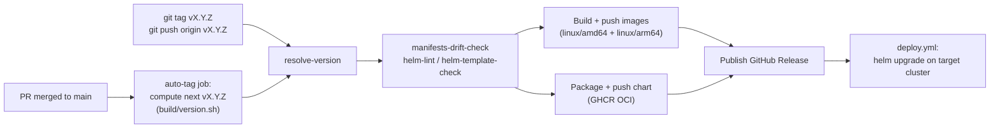

# Release Process

Referenced from the main [README](../README.md#release-process), which only covers the
high-level flow — this file has the full pipeline, versioning rules, manual releases, and
CI/GHCR gotchas.



`release.yml` and `deploy.yml` replace the previous `platform-deploy-chart.yml`.

| Workflow | Trigger | Does |
|---|---|---|
| `release.yml` | Push to `main`, or a `vX.Y.Z` tag pushed by hand | Resolves the version, builds both images (multi-arch), packages + pushes the Helm chart, publishes the GitHub Release |
| `deploy.yml` | A GitHub Release is published, or manual `workflow_dispatch` | Deploys that exact version to the target cluster via a single `helm upgrade --install` |
| `platform-verify-chart.yml` | Every push/PR | Unchanged — builds and deploys to a throwaway Kind cluster in CI, no registry involved |

<a id="versioning"></a>
## Versioning

`build/version.sh` computes the next tag:
1. Finds the latest `vX.Y.Z` tag that's an ancestor of the current commit.
2. No such tag yet → `v1.0.0`, no bump applied.
3. Otherwise scans commit messages since that tag for Conventional Commits: `BREAKING`/`!:` → major, `feat:` → minor, anything else (including plain messages) → patch.

No PR-title enforcement is in place, so an un-prefixed commit message defaults to a patch bump.

<a id="manual-release"></a>
## Manual Release

To cut a release outside the normal merge-to-main flow (e.g. a hotfix from another branch):
```bash
git tag v1.4.1 <commit-or-branch>
git push origin v1.4.1
```
This runs the exact same `release.yml` pipeline as an automatic release — only the `auto-tag` job is skipped, since the tag already exists.

<a id="what-gets-published"></a>
## What Gets Published

- **Images** — `ghcr.io/HIRO-MicroDataCenters-BV/hiro-adaptive-orchestrator/hiro-adaptive-orchestrator-controller:vX.Y.Z` and `hiro-scheduler:vX.Y.Z-k8s<SCHED_K8S_VERSION>`, both built for `linux/amd64` and `linux/arm64`. Also tagged `sha-<commit>` and `latest`.
- **Chart** — `oci://ghcr.io/HIRO-MicroDataCenters-BV/hiro-adaptive-orchestrator/charts/hiro-adaptive-platform`, chart version = the release tag without its leading `v`.
- **GitHub Release** — auto-generated notes, with the packaged chart `.tgz` attached.

<a id="deploying"></a>
## Deploying

`deploy.yml` needs the `TARGET_KUBECONFIG` repo secret (base64-encoded kubeconfig). See the header comment in [.github/workflows/deploy.yml](../.github/workflows/deploy.yml) for the full list of secrets/variables it reads (namespace, release name, scheduler mode, webhook/cert-manager toggles, etc.).

Before deploying, it checks the target cluster against the `prerequisites.*` toggles: it fails outright if `WEBHOOK_TLS_MODE=certManager` but cert-manager isn't installed on the cluster (the default, `helm`, generates the webhook certificate in-chart and needs nothing installed), and warns (without blocking) if metrics-server or Prometheus are missing, since those only degrade rebalance pressure triggers or metrics scraping respectively.

To redeploy a past version without rebuilding anything: **Actions → Deploy to Target Cluster → Run workflow**, supplying the version tag.

<a id="adding-a-new-image-to-the-pipeline"></a>
## Adding a New Image to the Pipeline

A brand-new container image's first push from `release.yml` will fail with `denied: permission_denied: read_package`, even though the workflow's `GITHUB_TOKEN` already has `packages: write`. This is a GHCR quirk specific to *container*-type packages on this org — a brand-new Helm chart OCI push auto-links to the repo fine, but a brand-new container image push does not. One-time fix per new image name:

1. From a machine with Docker and a personal access token (`write:packages` scope), create the package once manually:
   ```bash
   echo "$GITHUB_PAT_TOKEN" | docker login ghcr.io -u <your-username> --password-stdin
   docker pull hello-world
   docker tag hello-world ghcr.io/hiro-microdatacenters-bv/hiro-adaptive-orchestrator/<new-image-name>:bootstrap
   docker push ghcr.io/hiro-microdatacenters-bv/hiro-adaptive-orchestrator/<new-image-name>:bootstrap
   ```
2. Find it under **github.com/orgs/HIRO-MicroDataCenters-BV/packages** (not the repo's own Packages tab — it won't show there yet).
3. Open its **Package settings** and do both: **Connect Repository** → `hiro-adaptive-orchestrator` (makes it show up under the repo), and **Manage Actions access** → add `hiro-adaptive-orchestrator` with **Write** role (the actual permission grant).
4. Delete the `bootstrap` tag once the pipeline pushes a real one.

After that one-time setup, `release.yml` pushes to that image normally on every future run.

Two smaller, already-applied gotchas worth knowing about if you touch the Dockerfiles or workflow files:
- Both Dockerfiles pin their builder stage to `FROM --platform=$BUILDPLATFORM ...` — removing that pin makes multi-arch builds compile under QEMU emulation instead of natively, which is dramatically slower (what looked like a stuck/hung build during development was this).
- GHCR repository paths must be lowercase; `github.repository` isn't guaranteed to be, so both workflows compute a lowercased `GHCR_REPO_LC`/`ghcr_repo_lc` rather than using `github.repository` directly in image/chart references.
