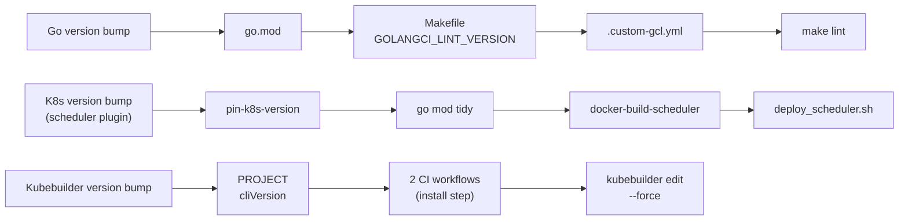

# Upgrading Go, Kubernetes, or Kubebuilder Version

Referenced from the main [README](../README.md#upgrading-go-or-kubernetes-version), which only
covers the summary — this file has the full version-bump procedures.



<a id="go-version"></a>
## Go Version

Three files must be kept in sync (not updated automatically by kubebuilder):

| File | Field |
|------|-------|
| `go.mod` | `go X.Y.Z` |
| `Makefile` | `GOLANGCI_LINT_VERSION` |
| `.custom-gcl.yml` | `version:` |

```bash
# 1. Update go.mod
go mod edit -go=X.Y && go mod tidy

# 2. Find a compatible golangci-lint version
curl -s "https://proxy.golang.org/github.com/golangci/golangci-lint/v2/@v/vX.Y.Z.mod" | grep "^go "

# 3. Update Makefile: GOLANGCI_LINT_VERSION ?= vX.Y.Z
# 4. Update .custom-gcl.yml: version: vX.Y.Z (must match)

# 5. Verify
rm -f bin/golangci-lint*
make lint
```

<a id="kubernetes-version-scheduler-plugin"></a>
## Kubernetes Version (scheduler plugin)

The scheduler binary must be compiled against the same Kubernetes minor version as the target cluster.

```bash
# Update scheduler-plugin/go.mod and rebuild
make pin-k8s-version SCHED_K8S_VERSION=v1.36.0
cd scheduler-plugin && go mod tidy

# Rebuild and push image
make docker-build-scheduler SCHED_K8S_VERSION=v1.36.0

# Redeploy scheduler with the new version
SCHED_K8S_VERSION=v1.36.0 deploy/scripts/deploy_scheduler.sh
```

The `pin_k8s_version.sh` script uses `go mod edit` to surgically update only the `k8s.io/kubernetes` require entry and the staging module replace directives — no full file rewrite.

<a id="kubebuilder-version"></a>
## Kubebuilder Version

Three places must be kept in sync (not updated automatically by kubebuilder):

| File | Field |
|------|-------|
| `PROJECT` | `cliVersion` |
| `.github/workflows/platform-verify-chart.yml` | "Install kubebuilder vX.Y.Z" step |
| `.github/workflows/release.yml` | "Install kubebuilder vX.Y.Z" step |

Both CI workflows pin to the exact release tag rather than `latest` — see the `manifests-drift-check` job in either file — so a kubebuilder tooling bump can never masquerade as a manifest-drift failure.

```bash
# 1. Update PROJECT's cliVersion, and both workflows' install step + download URL, to vX.Y.Z

# 2. Regenerate against the new scaffolding templates
IMG_NAME=$(awk '/newName:/{print $2}' config/manager/kustomization.yaml)
IMG_TAG=$(awk '/newTag:/{print $2}' config/manager/kustomization.yaml)
export IMG="${IMG_NAME}:${IMG_TAG}"
make manifests generate
rm -rf dist && kubebuilder edit --plugins=helm/v2-alpha --force

# 3. Review what actually changed — this should only touch scaffolding
#    surface (config/, api/**/zz_generated.deepcopy.go,
#    api/**/groupversion_info.go, dist/, cmd/main.go), never hand-written
#    business logic under internal/ or scheduler-plugin/
git diff -- config/ api/ dist/ cmd/main.go
```

A kubebuilder bump is usually paired with a dependency bump in the `go.mod` it now scaffolds by default (`go`, `sigs.k8s.io/controller-runtime`, `k8s.io/api`, `k8s.io/apimachinery`, `k8s.io/client-go`, `k8s.io/metrics`, and `sigs.k8s.io/controller-tools` via the Makefile's `CONTROLLER_TOOLS_VERSION`). Check the new version's release notes, bump `go.mod` (root module — `scheduler-plugin/`'s `k8s.io/kubernetes` pin tracks the target cluster version instead, see [Kubernetes Version](#kubernetes-version-scheduler-plugin) above, not this), `go mod tidy` both modules, and bump both Dockerfiles' `FROM golang:X.Y` to match.

This project overrides kubebuilder's default `<group>.<domain>` CRD group naming (using `orchestration.hiro.io` rather than the default `orchestration.orchestration.hiro.io`) so existing deployed CRs are never broken by a version bump — preserve the `SchemeGroupVersion`/`+groupName` values in `api/v1alpha1/groupversion_info.go` by hand across any regeneration.
